# 4. Nastavení operací (levý panel)

[← Záložka Deska](03-deska.md) · [Obsah](README.md) · [Další: Výstupy →](05-vystupy.md)

Levý panel má sbalovací sekce. V záhlaví každé sekce je vpravo krátké shrnutí
(např. `0,18 mm · 1×`), takže hned vidíš, co je nastavené, i když je sekce zavřená.
Každá změna se hned přepočítá a projeví v náhledu i v programech vpravo.

> **Tip:** v každém číselném políčku jdou hodnoty měnit šipkami `↑` `↓`
> (s `Shift` po desetinásobcích). Desetinnou čárku i tečku CuMill bere obě.

Obsah kapitoly:
[Knihovna nástrojů](#knihovna-nástrojů) ·
[Deska a nula](#deska-a-nula) ·
[Přípravek s kolíčky](#přípravek-s-kolíčky) ·
[Izolace mědi](#izolace-mědi) ·
[Díry](#díry) ·
[Další geometrie](#další-geometrie) ·
[Gravírování potisku](#gravírování-potisku) ·
[Ořez desky](#ořez-desky) ·
[Stroj a G-kód](#stroj-a-g-kód)

---

## Knihovna nástrojů

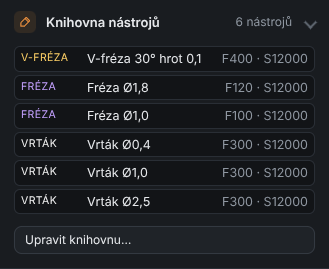

Seznam nástrojů, které máš. Každá operace si z nich vybírá. Tlačítkem **Upravit knihovnu…**
otevřeš tabulku, kde nástroje přidáš, smažeš nebo upravíš:

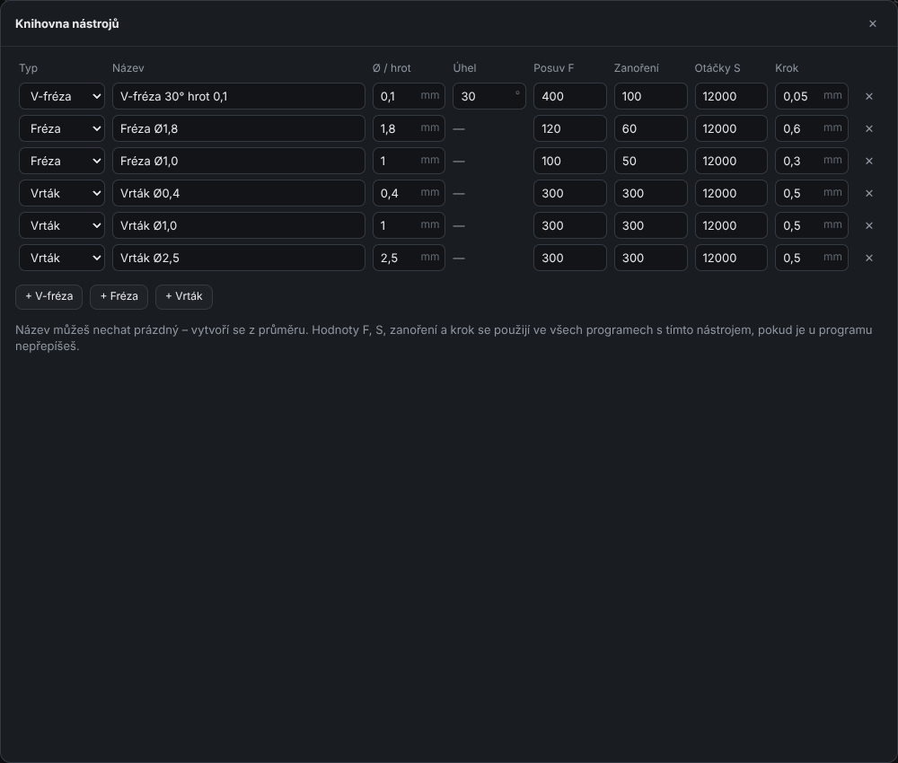

| Sloupec | Význam |
|---------|--------|
| **Typ** | *V-fréza* (kuželová, na izolaci a gravírování), *Fréza* (válcová – ořez, velké díry, kapsy), *Vrták* |
| **Název** | jak se nástroj ukazuje v nabídkách; prázdný = vytvoří se z průměru |
| **Ø / hrot** | průměr frézy či vrtáku; u V-frézy šířka hrotu (např. 0,1 mm) |
| **Úhel** | jen V-fréza: vrcholový úhel (např. 30°) – z něj se počítá šířka řezu podle hloubky |
| **Posuv F** | rychlost do strany v mm/min |
| **Zanoření** | rychlost dolů do materiálu v mm/min |
| **Otáčky S** | otáčky vřetena |
| **Krok** | jak hluboko jde nástroj na jeden průjezd (u ořezu 1,8 mm s krokem 0,6 = 3 průjezdy) |

Výchozí knihovna:

| Nástroj | F | Zanoření | S | Krok |
|---------|---|----------|---|------|
| V-fréza 30° hrot 0,1 | 400 | 100 | 12000 | 0,05 |
| Fréza Ø1,8 | 120 | 60 | 12000 | 0,6 |
| Fréza Ø1,0 | 100 | 50 | 12000 | 0,3 |
| Vrták Ø0,4 / Ø1,0 / Ø2,5 | 300 | 300 | 12000 | 0,5 |

Hodnoty z knihovny platí ve všech programech s tímto nástrojem, pokud je u konkrétního
programu nepřepíšeš (viz [Výstupy](05-vystupy.md#přepis-parametrů-jednoho-programu)).

---

## Deska a nula

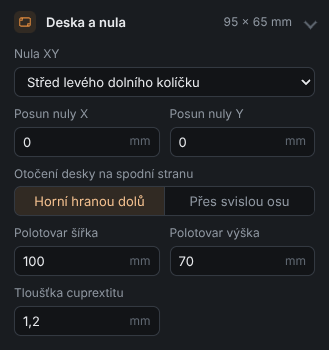

| Pole | Význam |
|------|--------|
| **Nula XY** | kde je na stroji X0 Y0: *střed levého dolního kolíčku* (oboustranné desky), *levý dolní roh desky*, *střed desky*, *pomocný počátek KiCadu* (Aux origin) nebo *počátek souřadnic KiCadu* |
| **Posun nuly X / Y** | posune nulu o zadanou hodnotu (např. když deska není v rohu polotovaru) |
| **Otočení desky na spodní stranu** | *Horní hranou dolů* (otáčíš přes vodorovnou osu – horní hrana se dostane k tobě) nebo *Přes svislou osu* (jako stránku v knize). Podle toho se spodní strana zrcadlí. |
| **Polotovar šířka / výška** | rozměr cuprextitu; kontroluje se, jestli se deska a kolíčky vejdou |
| **Tloušťka cuprextitu** | výchozí hloubka ořezu a výpočet výšky můstků |

> **Jak vybrat nulu:** u oboustranné desky nech *střed levého dolního kolíčku*. Kolíček je
> po otočení desky pořád na stejném místě, takže nula XY sedí na obou stranách.
> U jednostranné desky je nejjednodušší *levý dolní roh desky*.

---

## Přípravek s kolíčky

Kolíčky zajistí, že po otočení desky sedí spodní strana přesně na horní.
Princip: nejdřív se vyvrtají díry skrz desku **až do podložky (MDF)**, do nich se zasunou
kolíčky (třeba kousky ocelového drátu Ø2,5) a deska se pak otáčí kolem nich.

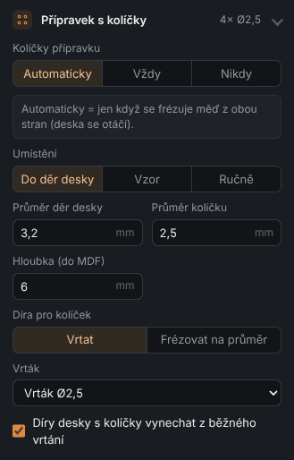

| Pole | Význam |
|------|--------|
| **Kolíčky přípravku** | *Automaticky* = jen když se frézuje měď z obou stran; *Vždy*; *Nikdy* |
| **Umístění** | *Do děr desky* (použijí se montážní díry zadaného průměru), *Vzor* (obdélník zadané rozteče kolem desky), *Ručně* (umístíš nástrojem Kolíček – viz [kapitola 3](03-deska.md#kolíčky-přípravku-ručně)) |
| **Průměr děr desky** | jen *Do děr desky*: které díry jsou montážní (např. 3,2 mm) |
| **Rozteč X / Y** | jen *Vzor* |
| **Průměr kolíčku** | např. 2,5 mm |
| **Hloubka (do MDF)** | jak hluboko vrtat, aby kolíček držel (např. 6 mm) |
| **Díra pro kolíček** | *Vrtat* (vrtákem) nebo *Frézovat na průměr* (frézou na přesný průměr) |
| **Vrták / Fréza** | nástroj z knihovny |
| **Díry desky s kolíčky vynechat z běžného vrtání** | montážní díra se nevrtá podruhé |

Kontroly hlídají kolíček v mědi, kolíček na desce mimo díru, kolíček mimo polotovar
a kolíček v dráze ořezu.

---

## Izolace mědi

Hlavní operace – V-fréza objede všechny cesty a plošky a tím je odizoluje od okolní mědi.

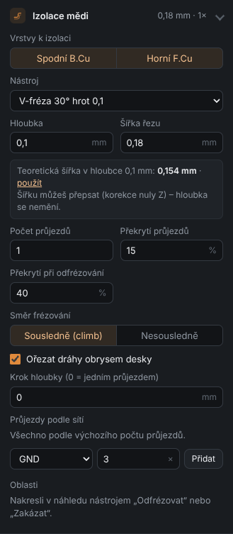

| Pole | Význam |
|------|--------|
| **Vrstvy k izolaci** | *Spodní B.Cu* a/nebo *Horní F.Cu* |
| **Nástroj** | V-fréza nebo válcová fréza z knihovny |
| **Hloubka** | jak hluboko jde fréza do mědi (typicky 0,08–0,12 mm; měď má 0,035 mm) |
| **Šířka řezu** | jak široká drážka vznikne. Předvyplní se z hrotu, úhlu a hloubky. |
| **Teoretická šířka** | spočítaná šířka V-frézy v zadané hloubce; odkazem *použít* ji nastavíš |
| **Počet průjezdů** | 1 = jedna drážka kolem cest; 2–4 = širší izolace (snazší pájení) |
| **Překrytí průjezdů** | o kolik % se sousední průjezdy překrývají |
| **Překrytí při odfrézování** | totéž pro oblasti „Odfrézovat měď“ |
| **Směr frézování** | *Sousledně (climb)* – čistší hrana na malých frézkách; *Nesousledně* |
| **Ořezat dráhy obrysem desky** | dráhy nepřesahují obrys desky |
| **Krok hloubky** | 0 = jedním průjezdem; jinak po krocích (např. 0,15 po 0,05) |
| **Průjezdy podle sítí** | vlastní počet průjezdů pro síť (např. GND → 3×) |
| **Oblasti** | seznam nakreslených oblastí odfrézování / zákazu |

> **Proč přepsat šířku řezu?** Skutečná V-fréza bývá trochu jiná, než říká výrobce,
> a hloubka se mění podle rovnosti desky. Když po zkušebním řezu změříš drážku
> (např. 0,2 mm), napiš ji do **Šířky řezu**. CuMill podle ní posune dráhy, aby cesty
> vyšly ve správné šířce. **Hloubka se tím nemění.**

---

## Díry

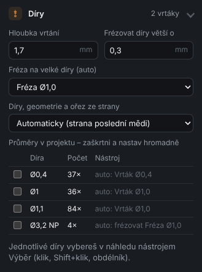

| Pole | Význam |
|------|--------|
| **Hloubka vrtání** | o kolik hlouběji než deska (deska 1,6 + rezerva → 1,7) |
| **Frézovat díry větší o** | díra větší než tvůj největší vrták o víc než tuto hodnotu se vyfrézuje; ostatní díry se vrtají nejbližším vrtákem z knihovny |
| **Fréza na velké díry (auto)** | čím frézovat velké díry |
| **Díry, geometrie a ořez ze strany** | *Automaticky* (ze strany, která se frézuje jako poslední – deska se už neotáčí), *Shora*, *Zespodu (zrcadleně)* |
| **Průměry v projektu** | tabulka všech průměrů: kolik děr, čím se udělají. Zaškrtni víc řádků a nastav jim hromadně nástroj, např. díry 1,0 + 1,1 + 1,2 → všechny vrtákem 1,0. |

Jednotlivé díry upravíš v náhledu nástrojem **Výběr** – viz [kapitola 3](03-deska.md#díry).
`NP` u průměru = neprokovená (mechanická) díra.

---

## Další geometrie

Tvary z ostatních vrstev KiCadu – **User.\***, **Dwgs.User**, **Cmts.User**, **Eco**,
**F.Fab** apod. (i tvary uvnitř pouzder). Hodí se na výřezy, drážky, kapsy pro součástky,
značky.

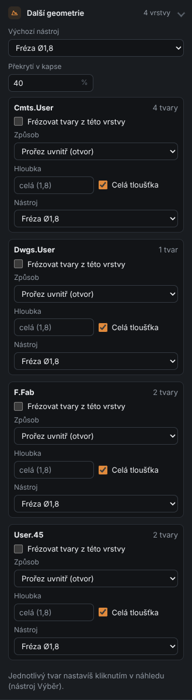

Pro každou vrstvu:

- **Frézovat tvary z této vrstvy** – zapne vrstvu,
- **Způsob** – *Prořez uvnitř (otvor)* – fréza jede uvnitř tvaru, vznikne díra přesného tvaru; *Prořez vně (díl)* – fréza jede vně, vznikne díl přesného tvaru; *Kapsa (celá plocha)* – vyfrézuje celou plochu do hloubky; *Po čáře (rytí)* – fréza jede přesně po čáře,
- **Hloubka** nebo **Celá tloušťka**,
- **Nástroj**.

Jednotlivé tvary můžeš vybrat v náhledu (nástroj Výběr) a nastavit jim vlastní způsob.

---

## Gravírování potisku

V-fréza vyryje do mědi nebo laminátu texty a obrysy součástek z vrstev potisku
**F.SilkS** / **B.SilkS** – stejným čárovým písmem, jaké používá KiCad.

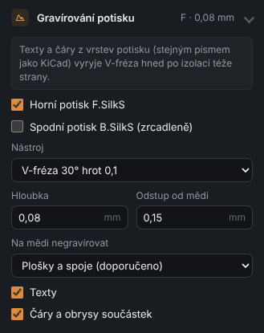

| Pole | Význam |
|------|--------|
| **Horní potisk F.SilkS / Spodní potisk B.SilkS** | co gravírovat (spodní se zrcadlí) |
| **Nástroj, Hloubka** | typicky V-fréza 30°, 0,05–0,1 mm |
| **Odstup od mědi** | jak daleko od mědi se gravírování zastaví |
| **Na mědi negravírovat** | *Plošky a spoje* (doporučeno – nic se nepřeruší), *Jen plošky*, *Veškerou měď*, *Nic* |
| **Texty / Čáry a obrysy součástek** | co z potisku použít |

Gravírování se zařadí hned za izolaci stejné strany (stejný nástroj, bez výměny).
Funguje jen u desky z KiCadu (`.kicad_pcb`).

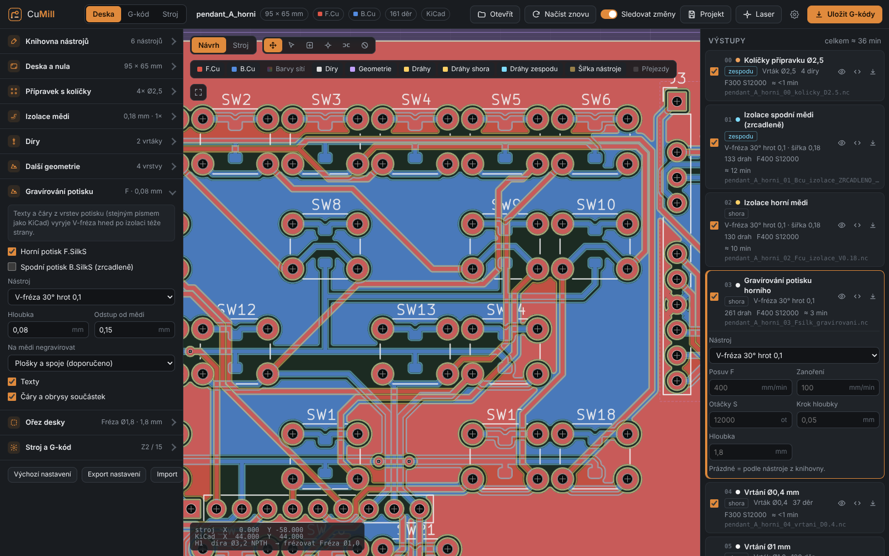

---

## Ořez desky

Vyřízne hotovou desku z polotovaru podle obrysu **Edge.Cuts**.

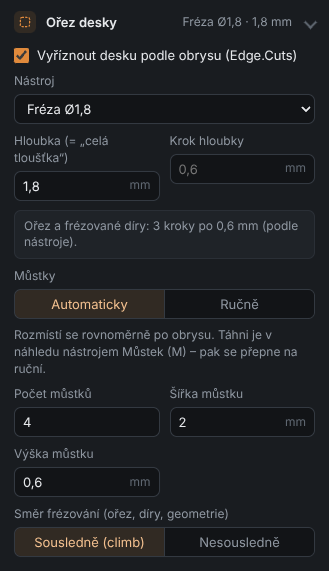

| Pole | Význam |
|------|--------|
| **Vyříznout desku podle obrysu** | zapne ořez |
| **Nástroj** | válcová fréza (typicky 1,8–2 mm) |
| **Hloubka** | celá tloušťka + rezerva (např. 1,8 mm u desky 1,6) |
| **Krok hloubky** | prázdné = podle nástroje; ukazuje se, kolika kroky to pojede |
| **Můstky** | *Automaticky* (rovnoměrně po obrysu) nebo *Ručně* (nástroj Můstek) |
| **Počet můstků** | jen Automaticky; 0 = bez můstků |
| **Šířka / Výška můstku** | např. 2 mm široký, 0,6 mm vysoký |
| **Směr frézování** | pro ořez, frézované díry a geometrii |

> **Výška můstku se měří od spodku desky.** Deska 1,2 mm a můstek 0,6 mm → nad můstkem
> fréza jede v hloubce −0,6 mm. Můstky pak stačí přeříznout nožem.

Můstky jdou i na vnitřní výřezy. Kontrola upozorní na můstek mimo dráhu ořezu nebo
na můstek vyšší než hloubka ořezu.

---

## Stroj a G-kód

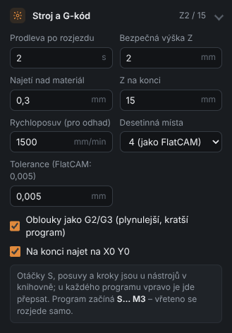

| Pole | Význam |
|------|--------|
| **Prodleva po rozjezdu** | čekání po zapnutí vřetena (než naběhne otáčky) |
| **Bezpečná výška Z** | výška přejezdů nad deskou |
| **Najetí nad materiál** | odkud se zanořuje pracovním posuvem (rychle se jede jen sem) |
| **Z na konci** | kam vyjede vřeteno na konci programu (aby šla deska vyndat) |
| **Rychloposuv (pro odhad)** | jen pro odhad času |
| **Desetinná místa** | 3 (µm) nebo 4 (jako FlatCAM) |
| **Tolerance** | přesnost nahrazování křivek (FlatCAM: 0,005 mm) |
| **Oblouky jako G2/G3** | oblouky se zapíšou jako G2/G3 – program je 6–10× kratší a GRBL jede plynuleji |
| **Na konci najet na X0 Y0** | po skončení vyjede nad nulu |

Každý program začíná `S… M3` – vřeteno se rozjede samo (nemusíš ho pouštět ručně).

### Výchozí nastavení, export a import

Pod sekcemi jsou tlačítka:

- **Výchozí nastavení** – vrátí vše (i knihovnu nástrojů) do továrního stavu,
- **Export nastavení / Import** – uloží nebo načte nastavení do souboru (např. pro jinou frézku).

[← Záložka Deska](03-deska.md) · [Obsah](README.md) · [Další: Výstupy →](05-vystupy.md)
