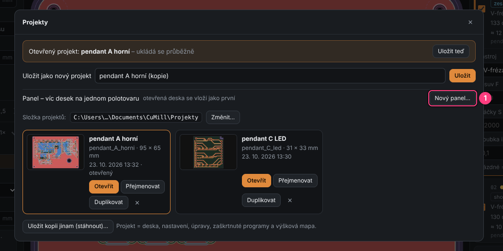
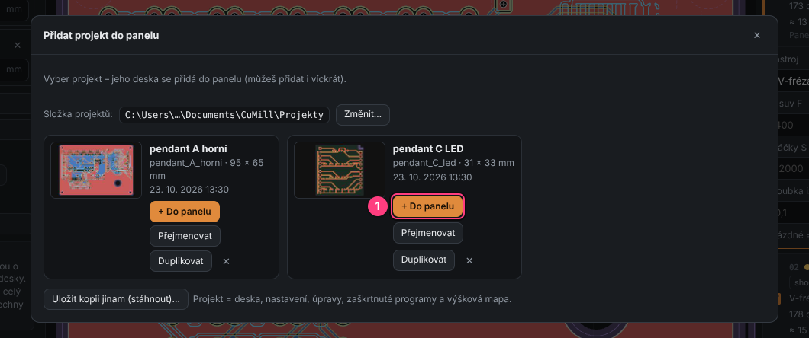
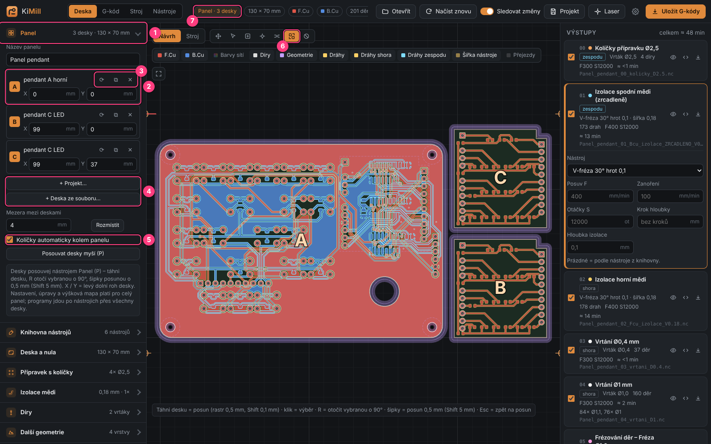
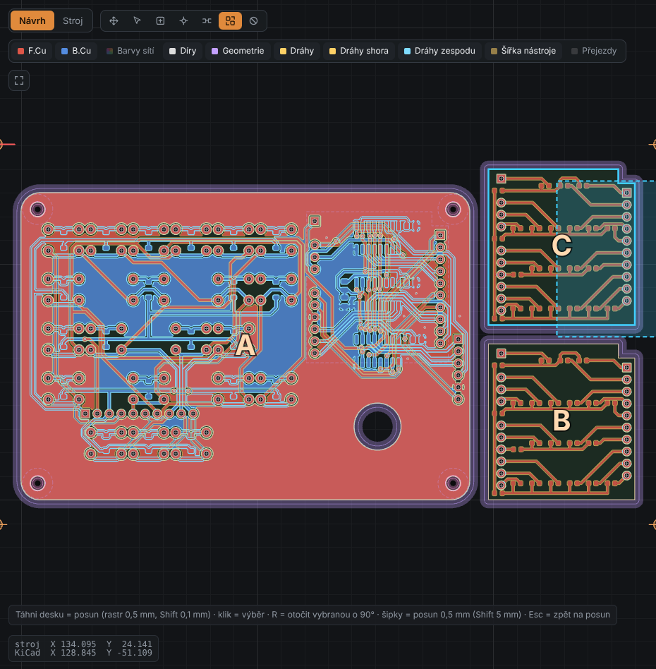
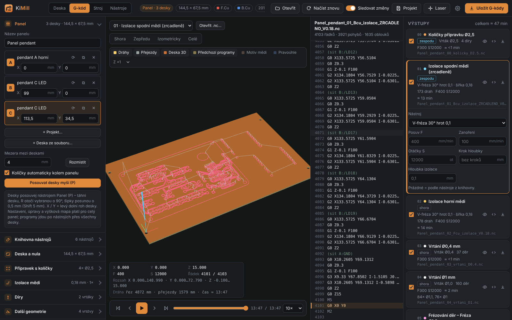

# 15. Panel – víc desek naráz

[← Test materiálu](14-test-materialu.md) · [Obsah](README.md)

**Panel** je projekt, ve kterém je na jednom polotovaru **víc desek** – různých, nebo
několikrát té samé. Desky rozmístíš myší, KiMill zkontroluje, že se nepřekrývají a vejdou
se na polotovar, a pak se vše vyrobí **najednou po nástrojích**: jedna izolace přes všechny
desky, jedno vrtání každým vrtákem, jeden ořez všech desek i s můstky. Výšková mapa se měří
jednou přes celý panel.

## Založení panelu

1. Otevři **Projekt** (tlačítko nahoře) → **Nový panel…**

   

2. Zadej název panelu. Když máš zrovna otevřenou desku, vloží se do panelu jako první.
3. Další desky přidáš v sekci **Panel** vlevo:
   - **+ Projekt…** – vybereš uložený projekt a klikneš **+ Do panelu** (klidně víckrát –
     každé kliknutí = další kus),
   - **+ Deska ze souboru…** – rovnou `.kicad_pcb` nebo gerbery.

   

Panel se ukládá jako běžný projekt (průběžně, do složky projektů). Desky jsou v něm uložené
celé, takže se otevře i tehdy, když původní soubory z KiCadu už nemáš.

## Sekce Panel a rozmístění

1. **Panel** – počet desek a celkový rozměr.
2. **Deska** – písmeno (A, B, C…), název a poloha **X / Y** levého dolního rohu v mm.
   Klik na písmeno desku vybere.
3. **⟳** otočí desku o 90°, **⧉** přidá další kus téže desky, **✕** ji z panelu odebere.
4. **+ Projekt… / + Deska ze souboru…** – přidání desek. Pod tím **Mezera mezi deskami**
   a **Rozmístit** – desky se samy poskládají na polotovar (největší první, co nejníž a nejvíc vlevo).
5. **Kolíčky automaticky kolem panelu** – vzor 4 kolíčků se sám přizpůsobí velikosti panelu.
   Vypni, když chceš kolíčky nastavit ručně v sekci *Přípravek s kolíčky*.
6. Nástroj **Panel** (klávesa `P`) – posouvání desek myší.
7. Štítek **Panel · N desek** v horní liště.

### Posouvání myší

**Chyť desku kdekoli myší a táhni ji** – jde to nástrojem **Posun** (výchozí) i nástrojem **Panel** (`P`). Nad deskou se kurzor změní na šipky posunu; tažení mimo desky posouvá pohled (s `Alt` posouvá pohled i nad deskou). Během tažení se ukazuje čárkovaný obrys nové
polohy, posun skáče po **0,5 mm** (se `Shift` po 0,1 mm).

| Klávesa | Co udělá |
|---------|----------|
| `P` | nástroj Panel |
| `R` | otočit vybranou desku o 90° |
| šipky | posun vybrané desky o 0,5 mm |
| `Shift` + šipky | posun o 5 mm |
| `Esc` | zpět na posun pohledu |

## Kontroly

- **Překryv** – když jsou dvě desky blíž, než projede fréza ořezu (průměr frézy + 0,2 mm),
  objeví se chyba *Desky A a B jsou příliš blízko*.
- **Polotovar** – panel i kolíčky se musí vejít na polotovar (sekce *Deska a nula*), jinak chyba.
- Upozornění z jednotlivých desek se zobrazí s předponou *Deska B (název): …*.

## Výroba

Programy vpravo jsou **společné pro celý panel** – ve [vizualizéru](06-vizualizer.md) uvidíš,
že jedna izolace jde přes všechny desky. V G-kódu jsou sítě označené písmenem desky
(např. `(sit B:/LD12)`), díry v tabulce děr mají označení `B·R3`.

Výrobní postup je stejný jako u jedné desky ([kapitola 9](09-vyroba-krok-za-krokem.md)):
upnout polotovar, kolíčky, výšková mapa přes celý panel, izolace, vrtání, ořez s můstky.

**Platí pro celý panel:** nastavení operací, ruční úpravy (oblasti, díry, kolíčky, můstky),
zaškrtnuté programy a výšková mapa. Úpravy z původních projektů jednotlivých desek se do panelu
nepřenášejí – jen samotné desky.

> **Tip:** úpravy s pevnou polohou (oblasti, ručně přidané kolíčky a můstky) dělej až po
> rozmístění desek – když pak desku posuneš, zůstanou na původním místě.

[← Test materiálu](14-test-materialu.md) · [Obsah](README.md)
