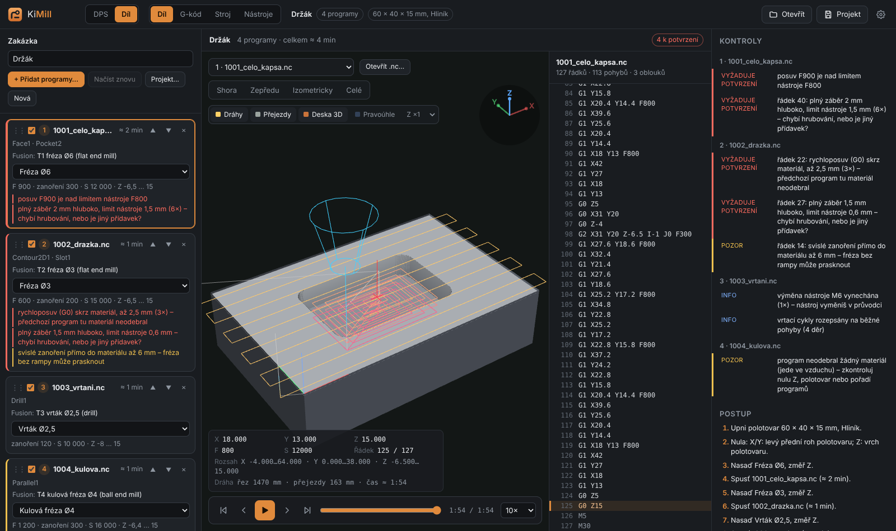
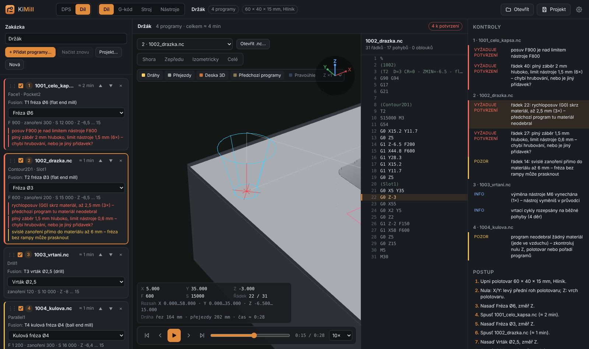
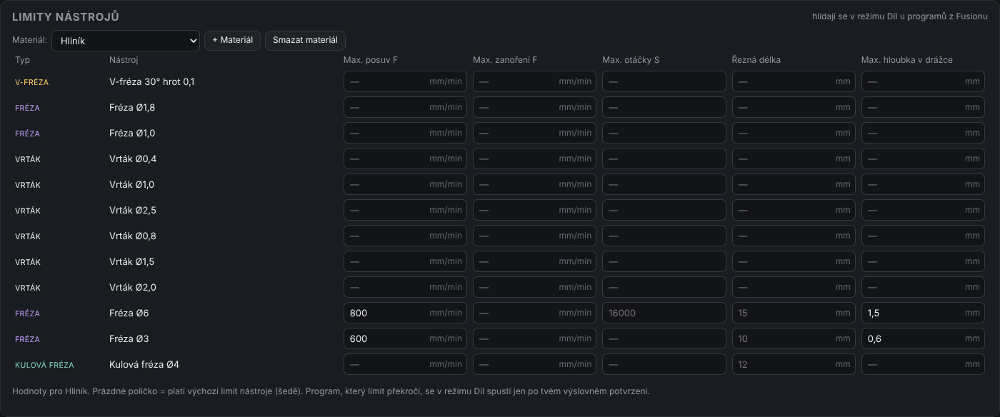
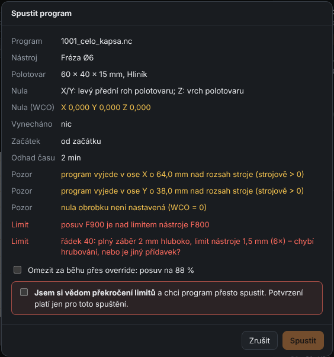

# 16. Díl – hotové G-kódy z Fusionu 360

[← Panel](15-panel.md) · [Obsah](README.md)

Režim **Díl** je pro obrábění dílů z hliníku, mosazi, dřeva nebo plastu, které si
připravíš ve **Fusionu 360**. KiMill v tomto režimu G-kód nevytváří. Převezme hotové
programy z Fusionu a vyrobí z nich jednu **zakázku**. Hlídá u ní nástroje, limity a úběr
materiálu přes všechny programy a ve Stroji tě provede výrobou jako u desky: výměna
nástroje, měření Z, spuštění.

Hodí se hlavně s osobní licencí Fusionu, která neumí uložit víc nástrojů do jednoho
programu. Uložíš každý nástroj zvlášť a KiMill je spojí do jednoho postupu.

## Přepnutí režimu

Vlevo nahoře vedle loga je přepínač **DPS | Díl**. V režimu Díl:

- místo záložky **Deska** je záložka **Díl** (F2),
- **G-kód**, **Stroj** a **Nástroje** zůstávají, ale pracují s programy dílu,
- tlačítka, která jsou jen pro desky (Uložit G-kódy, Laser, Tisk 1:1, Sledovat změny),
  se schovají.

KiMill si pamatuje režim i rozdělanou zakázku, takže po dalším spuštění pokračuješ tam,
kde jsi skončil.

## Export z Fusionu

1. V **Manufacture** připrav setupy a operace jako obvykle.
2. V **Setup → Stock** zadej polotovar a v **Setup → WCS** nulu (typicky levý přední roh
   a vrch polotovaru).
3. **Post Process** s postprocesorem **Grbl**. Každý nástroj ulož jako samostatný soubor
   `.nc`, například 1001, 1002, 1003. Osobní licence to tak stejně vyžaduje.
4. V postprocesoru nech **korekci poloměru „In computer“**. G41/G42 GRBL neumí.

## Zakázka – levý panel

**+ Přidat programy…** (nebo přetažení souborů do záložky) načte všechny `.nc` najednou.
Nové programy se seřadí podle názvu. Pořadí změníš přetažením karty (⋮⋮) nebo šipkami ▲ ▼.

Na kartě programu je:

- **zaškrtávátko**, jestli program patří do výroby,
- **operace z Fusionu** (Face1, Adaptive2…) a **nástroj z hlavičky**, např.
  `T1 fréza Ø6 (flat end mill)`. Čte se z komentáře, který Fusion zapisuje na začátek
  programu,
- **nástroj z knihovny**. KiMill ho přiřadí sám podle typu a průměru. Když v knihovně
  není, vyber ho, nebo klikni na **+ Do knihovny**. Nástroj se pak založí podle hlavičky
  (průměr, typ, F a S z programu),
- **F, zanoření, S a rozsah Z** programu a odhad času,
- **nálezy kontrol** (červeně = vyžaduje potvrzení, oranžově = pozor).

**Stejný název souboru = nová verze.** Po novém exportu z Fusionu stačí soubory přidat
znovu, nebo kliknout **Načíst znovu**. Pořadí ani přiřazené nástroje se nezmění.

Co KiMill v programu upraví pro GRBL (vypíše se v Kontrolách jako info):

| V programu | Co se stane |
|---|---|
| `M6` (výměna nástroje) | vynechá se, výměnu řídí průvodce |
| vrtací cykly `G81`, `G82`, `G83`, `G73` | rozepíšou se na obyčejné pohyby |
| `G98`, `G99`, `G64` | vynechají se |
| `G41`, `G42`, `G43` | **nejde spustit** (GRBL je nezná) |
| `G28`, `G30` | varování (jede na polohu uloženou ve stroji) |
| víc nástrojů (T) v jednom souboru | vyžaduje potvrzení (GRBL je nevymění) |

## Polotovar a nula

Pod programy zadej **rozměr polotovaru** (X × Y × tloušťka), **materiál** a kde má Fusion
**nulu**:

- **Nula X/Y**: levý přední roh, pravý přední, levý zadní, pravý zadní, střed, nebo vlastní
  (X, Y levého předního rohu polotovaru),
- **Nula Z**: vrch polotovaru, spodek polotovaru (stůl), nebo vlastní.

Musí to sedět s Fusionem. Podle toho KiMill simuluje úběr a pozná, kde ještě materiál je.

**Umístění programu v polotovaru.** Když je polotovar větší a díl nechceš mít v rohu,
zadej **Posun programu X / Y**, nebo klikni na **Na střed** (obráběná oblast doprostřed
polotovaru) či **K rohu s okrajem…**. KiMill přepočítá souřadnice X a Y ve všech programech
zakázky, oblouky i vrtání. Nula na stroji zůstává tam, kde ji má Fusion (třeba v rohu
polotovaru). Posun je vidět v 3D náhledu, v simulaci i v okně před spuštěním.
Pod polotovarem uvidíš, kde programy skutečně řežou. Když je to hodně mimo polotovar,
KiMill na to upozorní.

## Kontroly a simulace úběru

Po každé změně KiMill na pozadí nasimuluje **celou zakázku v pořadí**. Polotovar je mřížka
výšek s krokem asi 0,05 mm a nástroj má svůj tvar (válcová, kulová, V-fréza, vrták s hrotem).
Každý program ubírá materiál a další program vidí jen to, co zbylo. Průběh ukazuje
lišta nad 3D náhledem.

| Nález | Úroveň | Co znamená |
|---|---|---|
| rychloposuv (G0) skrz materiál | **potvrzení** | předchozí program tu materiál neodebral (chybí, je vypnutý nebo v jiném pořadí) |
| plný záběr hlouběji, než nástroj snese | **potvrzení** | dokončovací fréza jede do plného, chybí hrubování nebo je jiný přídavek |
| materiál nad řeznou délkou | **potvrzení** | stopka nebo upínací část se dotkne materiálu |
| hned první řez hluboko pod povrchem | **potvrzení** | nula Z nebo tloušťka polotovaru nesedí s Fusionem |
| zajetí víc než 1 mm pod spodek polotovaru | **potvrzení** | fréza zajede do podložky nebo stolu |
| F, zanoření nebo S nad limitem nástroje | **potvrzení** | podle limitů v knihovně (níže), u S i nad `$30` stroje |
| přiřazený nástroj nesedí s hlavičkou | **potvrzení** | v programu je jiný průměr nebo typ |
| svislé zanoření do materiálu | pozor | fréza bez rampy nebo šroubovice (vrták smí) |
| program neodebral nic | pozor | jede ve vzduchu – nula Z, polotovar nebo pořadí |
| nepodporovaný příkaz G41/G42/G43 | **nejde spustit** | oprav postprocesor |

Klik na nález s číslem řádku vybere program, posune 3D náhled na to místo (červený křížek)
a přetočí simulaci na ten řádek. 3D náhled vždy ukazuje polotovar **po všech předchozích
programech** a k tomu dráhy vybraného programu. Stejně to vypadá v záložkách **G-kód**
a **Stroj**.

Simulace je mřížka, takže na hranách, kde fréza jen škrtne o zbytek po předchozím průjezdu,
nehlásí drobnosti (tolerance kolem 0,1 mm). Je to kontrola proti hrubým chybám, ne náhrada
simulace ve Fusionu.

## Limity nástrojů (záložka Nástroje)

V záložce **Nástroje** je pod knihovnou karta **Limity nástrojů**:

- **Max. posuv F**, **Max. zanoření F**, **Max. otáčky S**,
- **Řezná délka**: jak hluboko smí nástroj do materiálu, než se dotkne stopka,
- **Max. hloubka v drážce**: nejhlubší řez plnou šířkou nástroje (při bočním záběru
  s malým přesahem, třeba adaptivním hrubováním, se nehlídá).

Limity zadáš **u nástroje (výchozí pro všechny materiály)** a pro konkrétní **materiál**
(Hliník, Mosaz, Dřevo, Plast, + vlastní). Prázdné políčko u materiálu znamená, že platí
výchozí hodnota nástroje (je vidět šedě). Prázdné políčko u výchozí hodnoty znamená, že se
limit nehlídá. Materiál zakázky vybereš u polotovaru.

V knihovně přibyl typ **Kulová fréza**.

## Spuštění s překročením limitu

Když program něco překračuje, **nespustí se bez tvého výslovného potvrzení**. V okně
před spuštěním (Stroj → Start) jsou nálezy vypsané červeně a tlačítko **Spustit** je vypnuté,
dokud:

- nezaškrtneš **„Jsem si vědom překročení limitů a chci program přesto spustit“**, nebo
- nezvolíš **„Omezit za běhu přes override“**. Platí, když jde jen o F a S: KiMill nastaví
  override posuvu a otáček tak, aby program limit nepřekročil (GRBL umí 10–100 %).

Potvrzení platí **jen pro toto jedno spuštění**. Při dalším startu se KiMill zeptá znovu.
Do konzole se zapíše, co jsi potvrdil. Když byl předchozí program omezený přes override,
další program dílu vrátí override na 100 %.

Nálezy úrovně **nejde spustit** (G41/G42/G43) potvrdit nejde. Oprav je ve Fusionu.

## Výroba – průvodce ve Stroji

Průvodce v záložce **Stroj** má pro díl kroky:

1. Připoj stroj.
2. Upni polotovar (rozměr a materiál ze zakázky).
3. Nastav nulu X Y. Text připomene, kde ji máš ve Fusionu.
4. Pro každý nástroj: **Nasaď nástroj** → **Změř Z** (destičkou, klipem u vodivého
   materiálu, na Z sondě, nebo **Z stejné jako předchozí** u stejně dlouhých nástrojů)
   → **Spusť** program.

Výšková mapa se v režimu Díl nepoužívá. Pokračování po přerušení, kontrolní běh, vynechání
části programu i deník fungují stejně jako u desek.

## Projekt dílu

**Projekt…** uloží zakázku do složky projektů jako `.kimill`: programy (i jejich kopie),
pořadí, přiřazené nástroje, polotovar a materiál. Pak se ukládá průběžně. Při otevření
KiMill přepne do režimu Díl a načte aktuální soubory z disku. Když už na původním místě
nejsou, použije kopie z projektu. Knihovnu nástrojů projekt dílu nemění.
