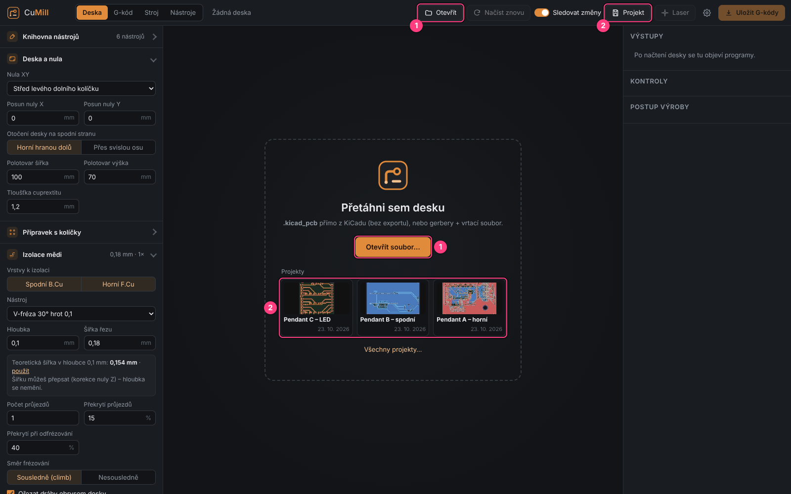
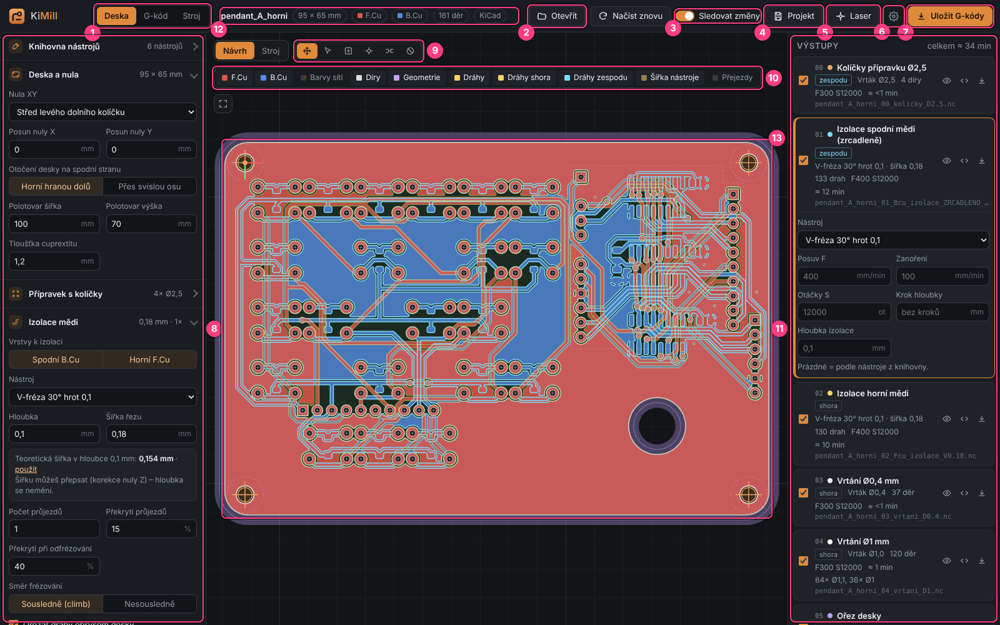

# 1. Installation and first start

[← Contents](README.md) · [Next: First board →](02-first-board.md)

## What you need

- **Windows 10 or 11** (64-bit). KiMill is a single file `KiMill.exe`; nothing is installed.
  Or **Linux** (PC and Raspberry Pi) – see [Linux](#linux) below.
- **Microsoft Edge WebView2** – almost always already present on Windows 10/11 (Office and Teams use it).
- For machine control: a CNC with **GRBL 1.1** connected via USB (COM serial port, 115200 baud).
- Boards from **KiCad 6 to 10** (`.kicad_pcb`), or Gerbers and a drill file from any other program.

## Download

1. Open the **[Releases](https://github.com/sladekdavid1-rgb/KiMill/releases)** page of the repository.
2. From the latest version download `KiMill.exe` and `WebView2Loader.dll`.
3. Put both files **in one folder**, e.g. `Documents\KiMill`.

> Without `WebView2Loader.dll` KiMill opens in an Edge browser window. It works the same,
> it just doesn't have its own window.

## First start

Double-click `KiMill.exe`.

For a program without a paid digital signature Windows may show a blue
**"Windows protected your PC"** screen. Click **More info** → **Run anyway**.
This happens only the first time.

The start screen appears:

**(1)** The **Otevřít soubor…** (Open file…) button – or **Otevřít** (Open) at the top, `Ctrl+O` –
opens a board. You can also **drag the board file** from Explorer into the window.

**(2)** Below the button are your **saved projects** with thumbnails (click = open, everything as you left it)
and the **recently opened boards**. All projects are under the **Projekt** button at the top
(see [chapter 5](05-outputs.md#projects)).

## Linux

KiMill also runs on Linux: on a PC (amd64), a Raspberry Pi 4/5 with a 64-bit OS (arm64) and older
Pis with a 32-bit OS (armv7). It does everything the Windows version does.

1. Download `KiMill-linux.tar.gz` from **Releases** and unpack it.
2. Run `./install.sh` in that folder. It installs KiMill into your home folder (no sudo) and adds it
   to the application menu. Uninstall: `./install.sh --remove`.
3. The installer checks and tells you what is missing:
   - the **`dialout` group** for access to the machine (`/dev/ttyUSB0`, `/dev/ttyACM0`):
     `sudo usermod -aG dialout $USER`, then log out and in,
   - **zenity** (or kdialog on KDE) for file dialogs: `sudo apt install zenity`. Without it files
     are opened only as copies and *Watch changes* and *Reload* do not work,
   - **Chromium or Chrome**: KiMill opens in it as its own window. If neither is installed,
     it opens in the default browser as a tab.

Differences from Windows:

- The machine is listed as `/dev/ttyUSB0` (CH340/FTDI adapter) or `/dev/ttyACM0` (Arduino), not `COM3`.
- Projects are in **Documents/KiMill/Projekty** as set in the system (`~/Dokumenty` in Czech),
  settings and the window profile in `~/.local/share/KiMill`.
- Move settings and the tool library from Windows with **Settings → Backup everything → Export / Import**.
  Just copy the `.kimill` projects.

## What KiMill remembers

- **Settings, tool library, themes, probe position, pendant keys** are remembered automatically
  (in the Windows user profile). Next time everything is as you left it.
- **Edits of a particular board** (manual pins, tabs, areas, hole changes) are remembered
  **with the board** and survive further changes of the board in KiCad.
- To move everything to another computer use **Nastavení → Zálohy → Exportovat vše**
  (Settings → Backups → Export everything), see [chapter 10](10-app-settings.md).

## Main window – what is where

| # | Element | Purpose |
|---|---------|---------|
| 1 | **Deska / G-kód / Stroj / Nástroje** | main tabs: Board / G-code / Machine / Tools (also `F2`, `F3`, `F4`, `F6`); Tools = tool library and test results ([chapter 14](14-material-test.md)) |
| 2 | **Otevřít** (Open) | load a `.kicad_pcb` board, Gerbers or a `.kimill` project |
| 3 | **Sledovat změny** (Watch changes) | when you save the board in KiCad, KiMill reloads and recomputes it |
| 4 | **Projekt** (Project) | projects: save the board as a project (board, settings, edits, height map – then saved continuously) and open saved projects |
| 5 | **Laser** | SVG export of silkscreen and mask for a laser (LightBurn) |
| 6 | **⚙ Nastavení** (Settings) | color themes, defaults, probe, keys, backups (`Ctrl+,`) |
| 7 | **Uložit G-kódy** (Save G-code) | saves the checked programs into a folder (`Ctrl+S`) |
| 8 | **Left panel** | settings of all operations (tools, origin, isolation, holes, cut-out…) |
| 9 | **Preview tools** | pan, select, areas, pins, tabs, no-mill zones |
| 10 | **Layers** | what is visible in the preview |
| 11 | **Right panel** | Výstupy (Outputs = programs), Kontroly (Checks), Postup výroby (Production steps) |
| 12 | **Board info** | name, size, copper layers, number of holes, source |
| 13 | **Board preview** | copper, tool paths, holes, pins; wheel = zoom, drag = pan |

[← Contents](README.md) · [Next: First board →](02-first-board.md)
