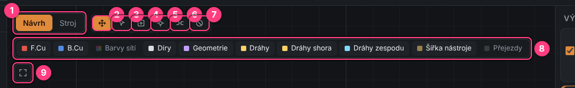
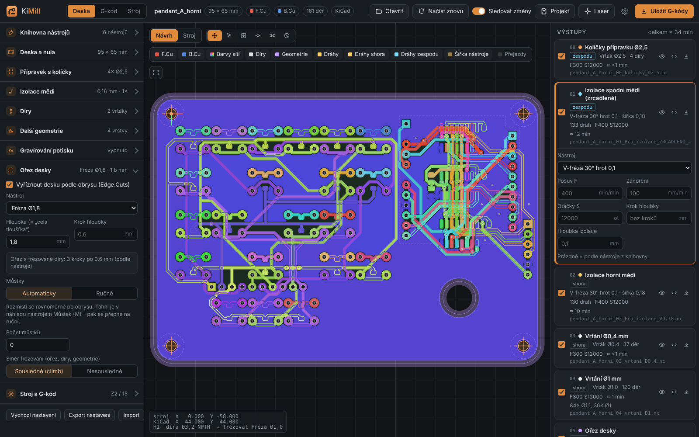
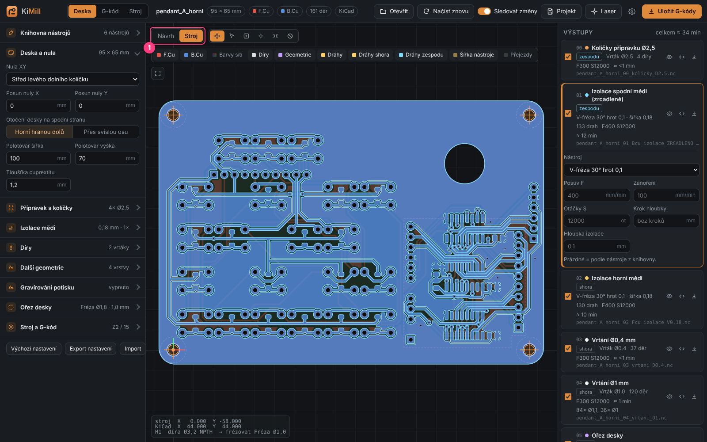
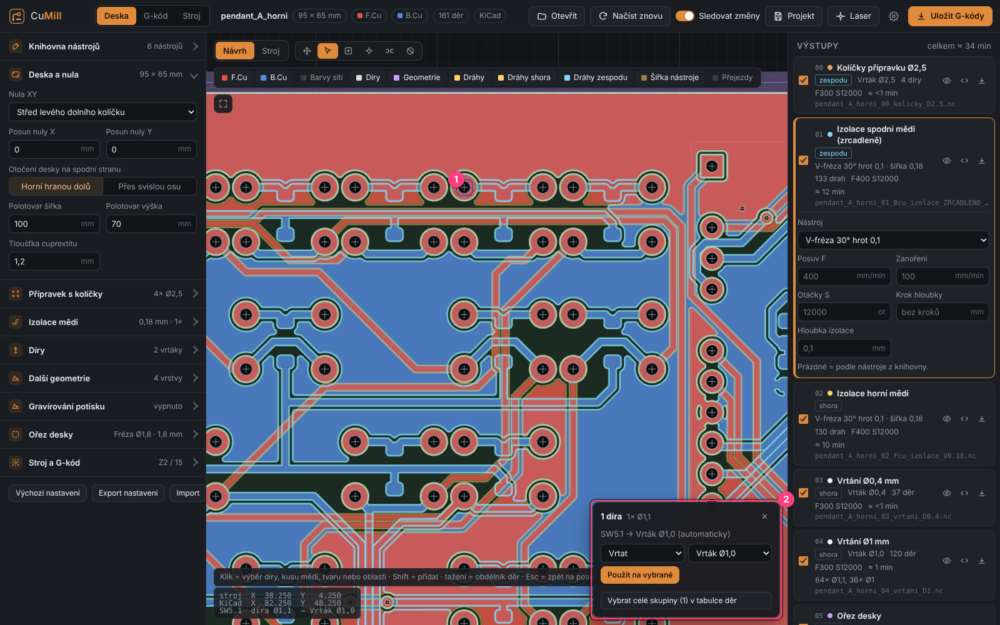
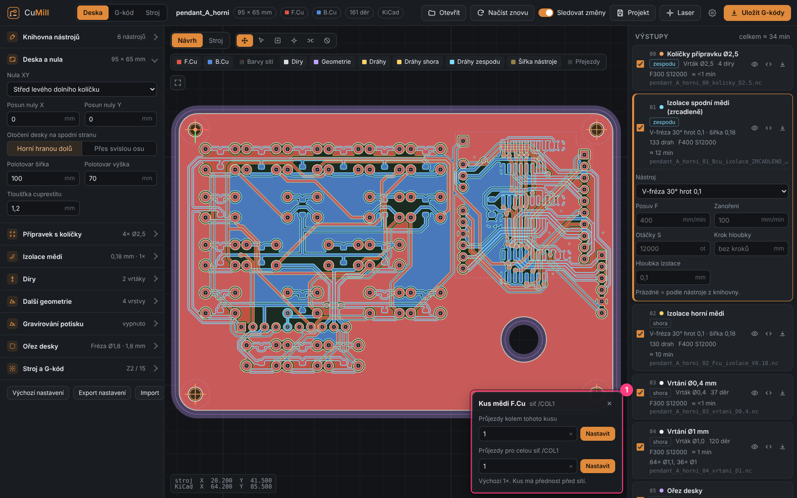
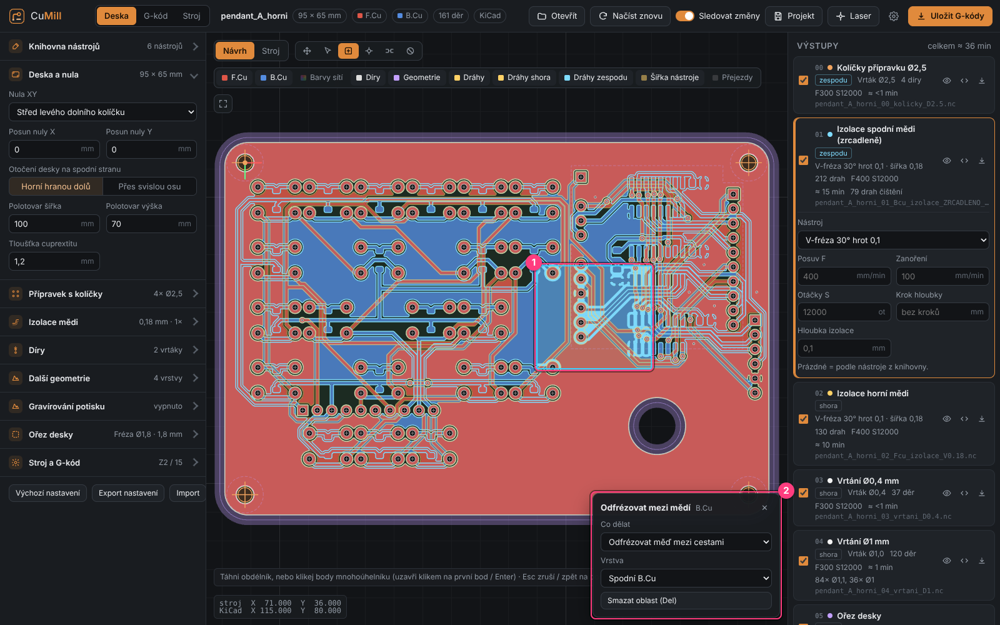
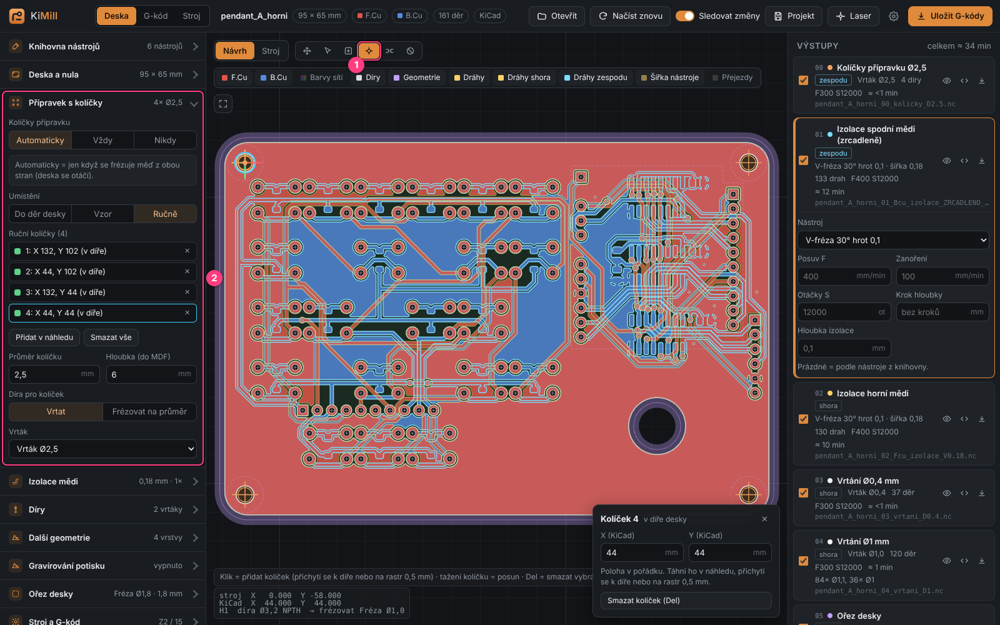
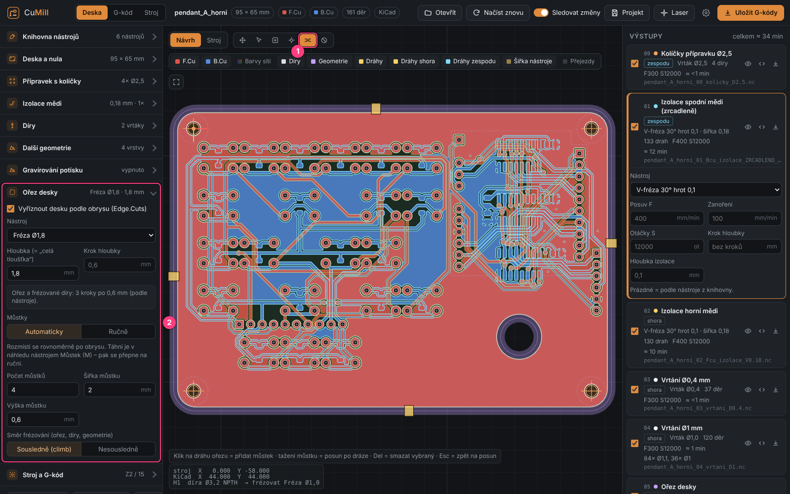

# 3. Board tab – preview and tools

[← First board](02-first-board.md) · [Contents](README.md) · [Next: Operation settings →](04-operation-settings.md)

The **Deska** (Board) tab (`F2`) is the main workspace. The board preview is in the middle,
with the tool bar and layer switches above it.

## Navigating the preview

| Action | How |
|--------|-----|
| Zoom | mouse wheel (zooms toward the cursor) |
| Pan | drag with the left button (Pan tool), or any time with the right / middle button |
| Whole board | double-click in the preview or the ⛶ button |
| Coordinates | bottom left shows the cursor position in **machine** and **KiCad** coordinates and what is under the cursor |

## Tool bar

| # | Tool | Key | What it does |
|---|------|-----|--------------|
| 1 | **Návrh / Stroj** (Design / Machine) | – | *Design* = the board as in KiCad. *Machine* = coordinates of the selected program as the CNC sees them (bottom side mirrored, origin at zero). |
| 2 | **Posun** (Pan) | `H` | pan the preview, click pins/tabs |
| 3 | **Výběr** (Select) | `V` | click selects a hole, copper piece, shape or area; `Shift`+click adds; drag = rectangle of holes |
| 4 | **Odfrézovat oblast** (Clear area) | `O` | draw an area where copper is milled away |
| 5 | **Kolíček** (Pin) | `K` | add and move jig pins by hand |
| 6 | **Můstek** (Tab) | `M` | add and move cut-out tabs by hand |
| 7 | **Zakázat frézování** (No-mill area) | `Z` | draw an area where no isolation is milled |
| 8 | **Layers** | – | what is visible (see below) |
| 9 | **Whole board** | double-click | fit the board to the window |

`Esc` always clears the selection and returns to the Pan tool.

### Preview layers

- **F.Cu / B.Cu** – top and bottom copper.
- **Barvy sítí** (Net colors) – colors copper and paths by net:

- **Díry** (Holes), **Geometrie** (shapes from extra layers), **Dráhy** (paths of all programs),
  **Dráhy shora / zespodu** (top / bottom paths separately), **Šířka nástroje** (paths drawn at the real cut width),
  **Přejezdy** (rapid moves).

### Machine view

The **Stroj** switch shows the selected program in machine coordinates. The bottom side
appears mirrored – exactly as it will lie on the table after flipping:

## Selecting and editing individual spots

### Holes

With the **Výběr** (Select, `V`) tool click a hole **(1)**. A box appears at the bottom right **(2)**
where you choose for the selected hole:

- **Vrtat** (Drill) – and with which drill from the library,
- **Frézovat** (Mill) – with an end mill, even to a different diameter (e.g. a 3.2 mm hole with a 1 mm mill),
- **Vynechat** (Skip) – the hole is not made at all.

Several holes: `Shift`+click or drag a rectangle. Whole groups of equal diameters are set in the
table in the **Díry** (Holes) section (see [chapter 4](04-operation-settings.md#holes)).

### Copper pieces and nets

Click on copper (a track, pad, zone). In the box set the **number of passes**:

- **around this piece** – only this copper island,
- **for the whole net** – e.g. go around the whole GND 4× to make soldering easier.

The piece setting has priority over the net setting. The list of edits is in **Izolace mědi →
Průjezdy podle sítí** (Copper isolation → Passes by net).

### Clearing copper in an area

**Odfrézovat oblast** (`O`) tool: drag a rectangle **(1)**, or click polygon points
(close by clicking the first point or `Enter`, `Backspace` removes the last point).
In the box **(2)** choose:

- **Odfrézovat měď mezi cestami** (Clear copper between tracks) – free copper in the area is removed, tracks stay,
- **Odfrézovat všechnu měď v oblasti** (Clear all copper in the area),
- and the **layer** (top / bottom).

Useful e.g. under an antenna, around high voltage or wherever you want bare laminate.
Delete an area with the `Del` key.

### No-mill area

The **Zakázat** (`Z`) tool is drawn the same way, but **no copper isolation is milled** in the area
on the chosen layer (top, bottom or both). Useful where solid copper should stay
(e.g. a large heat-sink pad). The area type can be changed any time in the selected area's box
(**Co dělat** – What to do).

### Jig pins (manual)

In **Přípravek s kolíčky** (Pin jig) switch **Umístění** (Placement) to **Ručně** (Manual)
and pick the **Kolíček** (Pin, `K`) tool **(1)**:

- click in the preview = **new pin** (snaps to a board hole or to a 0.5 mm grid),
- drag = **move**,
- `Del` = **delete** the selected pin.

The list of pins with positions is in the left panel **(2)**. A green dot = the pin is in a board hole,
red = warning (in copper, outside the blank or in the cut-out path).

### Rulers

At the bottom and left of the preview there are **rulers in cm** (mm ticks). Zero is the lower-left corner of the board
(in **Stroj** (machine) view the work zero). The orange band shows where the board is, a blue mark the mouse position.

The **overall size** of the board (of the whole panel for a panel) is visible at a glance: a label above the board
(e.g. *Panel 13,0 × 6,5 cm*) and dimension lines with arrows below and left of it (in cm and mm).

### Cut-out tabs (manual)

Tabs hold the board in the blank so it doesn't break loose during the cut-out. **Můstek** (Tab, `M`) tool **(1)**:

- move the mouse near the cut-out path – **the spot where the tab will go is highlighted** (snapped to the path, + cursor),
- click = **new tab** at the highlighted spot,
- over an existing tab the cursor turns into a hand – **drag = move along the path** (it sticks to it),
- **arrow keys** = move the selected tab along the path by 0.5 mm (`Shift` 5 mm),
- `Del` = delete.

Tab settings (count, width, height) are in the **Ořez desky** (Board cut-out) section **(2)**.
Dragging an automatically placed tab switches the board to manual tabs.

## Watching changes in KiCad

Turn on **Sledovat změny** (Watch changes) in the top bar. When you save the board in KiCad (`Ctrl+S`),
KiMill reloads and recomputes it. Manual edits (holes, pins, areas, tabs) are kept.
Reload manually with `F5` or **Načíst znovu** (Reload).

## Undo and redo

Every settings change and preview edit is undone with `Ctrl+Z` and redone with `Ctrl+Y`
(or `Ctrl+Shift+Z`). Up to 150 steps are kept.

[← First board](02-first-board.md) · [Contents](README.md) · [Next: Operation settings →](04-operation-settings.md)
