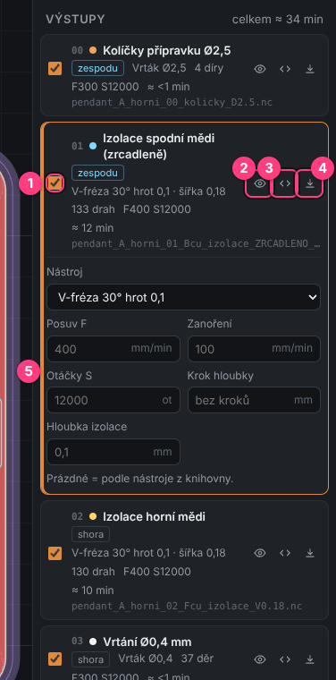
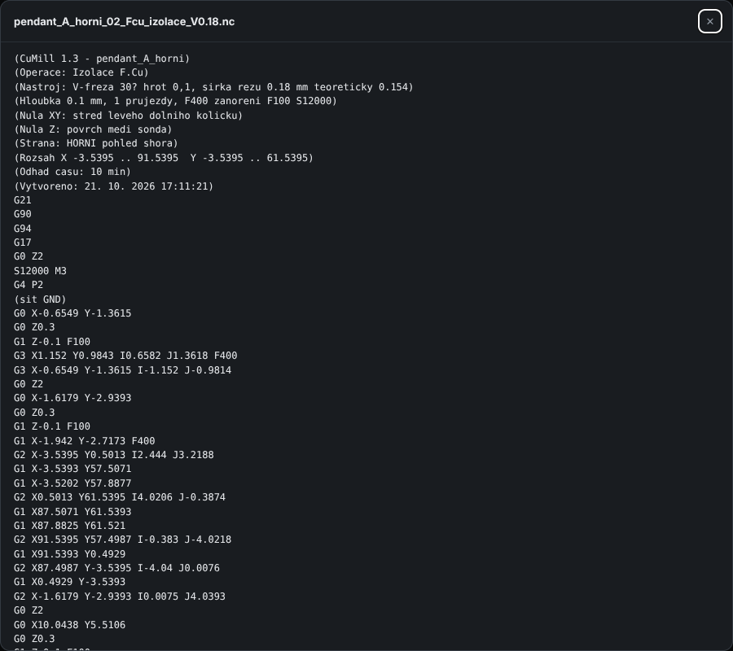
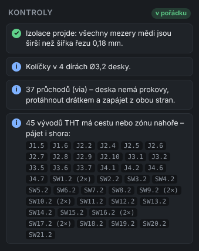
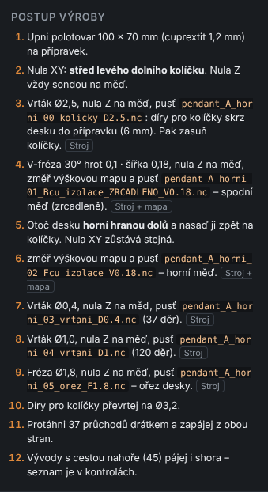
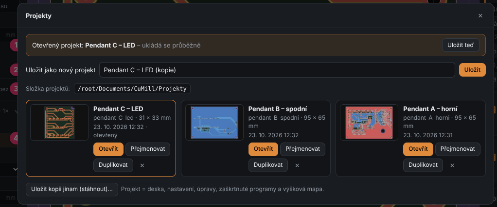
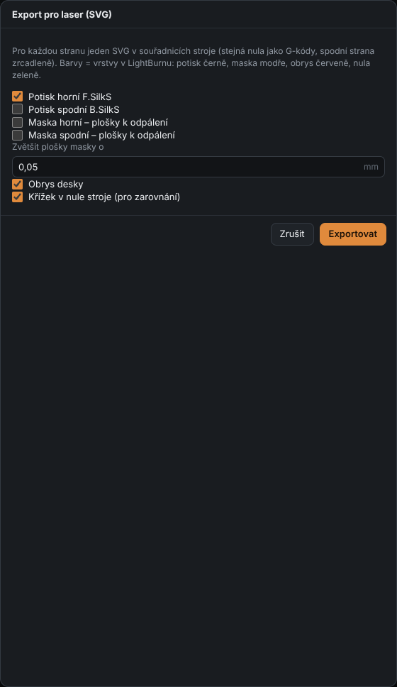

# 5. Outputs, checks and saving

[← Operation settings](04-operation-settings.md) · [Contents](README.md) · [Next: G-code viewer →](06-gcode-viewer.md)

The right panel of the **Deska** (Board) tab has three parts: **Výstupy** (Outputs = programs),
**Kontroly** (Checks) and **Postup výroby** (Production steps).

## Outputs – list of programs

Each row is one G-code program (one `.nc` file). The order is the production order.
The total time estimate is at the top right.

Each program shows: number, name, side (**shora** = top / **zespodu** = bottom), tool,
number of paths or holes, feed and spindle speed, time estimate and file name.

| # | Element | What it does |
|---|---------|--------------|
| 1 | **checkbox** | whether the program is saved by *Uložit G-kódy* (and included in the Wizard) |
| 2 | **eye** | hide / show the program's paths in the preview |
| 3 | **< >** | show the program's G-code |
| 4 | **down arrow** | save just this one file |
| 5 | **parameter override** | appears after clicking the program (see below) |

Clicking a program **selects** it – its paths are highlighted in the preview.

### Overriding parameters of one program

For the selected program you can change the **tool, feed F, plunge, spindle S, step-down**
and **depth** for this one program only. **Empty field = value from the tool library.**
The grey text in the field shows the value that will be used.

Example: you want the top isolation slower because of a fine bus → in the program
*Izolace horní mědi* (Top copper isolation) enter 250 into **Posuv F**. The bottom isolation stays at 400.

### Viewing the G-code

The **< >** button opens a window with the whole G-code. The header comments describe
the tool, depth, origin, side, extent and time estimate:

## Checks

KiMill checks the board and the settings after every change:

- **green ✓** – OK,
- **blue i** – information (e.g. how many vias to wire through),
- **yellow !** – warning, double-check it,
- **red !** – error, this won't turn out well.

The badge in the header shows a summary (*v pořádku* = OK / *upozornění* = warnings / *chyba* = errors).

What is checked (examples):

- **copper gaps** narrower than the cut width (isolation would fail) – with markers on the board,
- **pins** in copper, outside the blank, in the cut-out path,
- **tabs** off the cut-out path or higher than the board thickness,
- board **larger than the blank**, cut-out or drilling **shallower than the board**,
- holes drilled with a **much smaller / larger** drill, holes and cut-outs **smaller than the end mill**,
- a two-sided board **without jig pins** (flipping won't be accurate),
- **vias** – a home-made board has no plating, vias need a wire,
- **THT pins with a track on top** – must be soldered on top too (lists which).

Problem spots (e.g. too-narrow gaps) are marked in the board preview.

## Production steps

A step-by-step guide for **this particular board**: clamping, origin, which program to run when,
when to change the tool, when to probe the height map, when to flip the board. The **Stroj**
and **Stroj + mapa** labels tell what is needed in the Machine tab.

The same procedure, interactive (with buttons), is in **Stroj → Průvodce** (Machine → Wizard).

## Saving the G-code

**Uložit G-kódy** (Save G-code, `Ctrl+S`):

1. The first time it asks for a **folder** (e.g. the KiCad project folder).
2. Saves all **checked** programs.
3. **Deletes** older files of the same board in that folder so no outdated versions remain.
4. Next time it saves straight into the same folder. Choose another one with
   **Jiná složka…** (Another folder…) in the message shown after saving.

## Projects

The settings in the left panel (origin, isolation, depths, cut-out…) are **shared by all boards** – if you
prepare another board meanwhile, they change. To keep each board ready exactly as you left it, save it as a
**project**. The **Projekt** button at the top (or `Ctrl+Shift+S`) opens the Projects window:

| # | Part | What it does |
|---|------|--------------|
| 1 | **Otevřený projekt** (Open project) | the project you are working on; **Uložit teď** (Save now) saves immediately |
| 2 | **Uložit desku jako projekt** (Save board as project) | type a name and **Uložit** (Save); with a project open: *Save as new project* = a copy under another name |
| 3 | **Složka projektů** (Projects folder) | default `Documents\KiMill\Projekty`; **Změnit…** (Change…) picks another, **Výchozí** (Default) resets it |
| 4 | **Project list** | thumbnail, name, board, size, date; **Otevřít** (Open), **Přejmenovat** (Rename), **Duplikovat** (Duplicate), **✕** delete |

**What a project contains:** the board (a copy of the KiCad file or Gerbers), all settings and the tool library,
manual edits (holes, pins, tabs, areas, nets), checked programs and the **height map**.

**Continuous saving:** while a project is open, every change (settings, preview edit, program checkbox,
probed or edited height map) is **saved automatically** within about 2 seconds. The top bar shows a
**▣ project name** chip (click opens Projects). Opening another board closes the project (it stays saved).

**Returning to a project:** the start screen shows recent projects with thumbnails, or **Projekt** → **Otevřít**.
If the original KiCad file still exists, its **current** version is loaded (and *Watch changes* works),
otherwise the copy stored in the project. The height map is loaded too – before starting a program KiMill
warns when it is old (the board may have moved).

**Uložit kopii jinam (stáhnout)…** (Save a copy elsewhere) saves the project as a `.kimill` file anywhere
(e.g. a USB stick). Open such a file with **Otevřít** or by dragging it into the window.

## Laser export

The **Laser** button saves SVG files for a laser (e.g. LightBurn) – **in the same coordinates
as the G-code**, so the laser hits a board milled in the same place.

| Option | Exported | Color (LightBurn layer) |
|--------|----------|--------------------------|
| **Potisk horní / spodní** (Silkscreen top / bottom) | texts and component outlines | black |
| **Maska horní / spodní** (Mask top / bottom) | pads to ablate (e.g. from sprayed solder mask) | blue |
| **Zvětšit plošky masky o** (Enlarge mask pads by) | how much larger the mask opening is than the pad | – |
| **Obrys desky** (Board outline) | outline for alignment | red |
| **Křížek v nule stroje** (Cross at machine zero) | X0 Y0 mark to align the laser | green |

The bottom side is exported mirrored (same as the bottom G-code).

## Print 1:1

The **Tisk 1:1** (Print 1:1) button in the top bar prints the board (or the whole panel) **at real size** – a paper
template to cut out and lay on the copper-clad blank to see how the board fits.

- **Side:** *Jak leží na stroji* (as it lies on the machine – the first milled side), *Shora* (top) or *Zespodu* (bottom, mirrored).
- **Content:** by default **only the board** (all boards of a panel) – outline, copper (grey, the milled side darker),
  holes, a 1 cm grid with labels and a 50 mm check bar. The blank (dashed), fixture pins and the machine zero can be
  added – the print may get bigger then.
- The template opens in the **default browser** (Edge / Chrome) and immediately shows the normal **Windows print dialog**
  where you pick the printer. A4 (landscape or portrait by shape); KiMill warns when it is too big.

> In the print dialog set **scale 100 % / Actual size** (not *Fit to page*) and measure the check bar after
> printing – it must be exactly **5.0 cm**.

## Undo / redo

`Ctrl+Z` undoes the last settings change or preview edit, `Ctrl+Y` redoes it.

[← Operation settings](04-operation-settings.md) · [Contents](README.md) · [Next: G-code viewer →](06-gcode-viewer.md)
