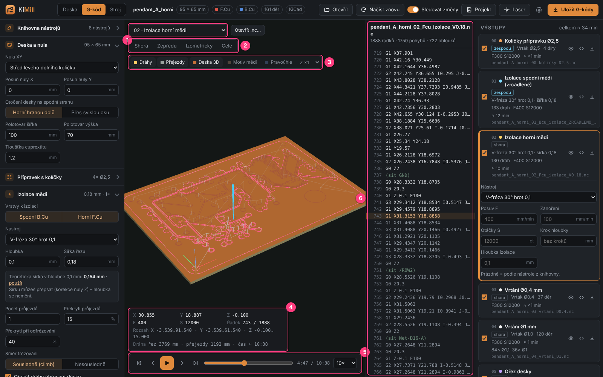
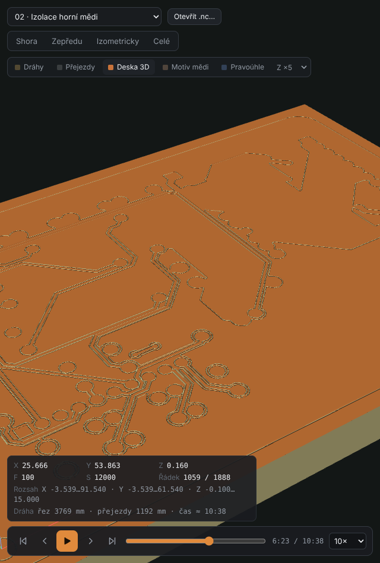

# 6. G-code viewer

[← Outputs](05-outputs.md) · [Contents](README.md) · [Next: Machine tab →](07-machine-tab.md)

The **G-kód** tab (`F3`) shows a program in 3D and plays it back like a video. It works like
the preview in Candle, but adds a **material-removal simulation** – you see what the cutter
actually takes out of the board.

| # | Element | What it does |
|---|---------|--------------|
| 1 | **Program selector** | a KiMill program (from the right panel) or an opened `.nc` file; next to it **Otevřít .nc…** (Open .nc…) |
| 2 | **Views** | *Shora* (Top), *Zepředu* (Front), *Izometricky* (Isometric), *Celé* (Fit) |
| 3 | **Switches** | *Dráhy* (Paths), *Přejezdy* (Rapids), *Deska 3D* (Board 3D simulation), *Předchozí programy* (Previous programs), *Motiv mědi* (Copper pattern), *Pravoúhle* (Orthographic), Z exaggeration *Z ×1–×20* |
| 4 | **Info** | X/Y/Z position, feed F, spindle S, line number, program extent, cut and rapid length, time estimate |
| 5 | **Playback** | to start, line back, play/pause, line forward, to end, slider, speed 1×–500× |
| 6 | **G-code listing** | the current line is highlighted; clicking a line moves the tool there |

## 3D navigation

| Action | How |
|--------|-----|
| Rotate | left mouse button |
| Pan | right button (or `Shift` + left) |
| Zoom | wheel |
| Fit program | double-click |
| Find line | click a path in the view → the listing jumps to the matching line |

## Path colors

- **blue** – moves above the material,
- **yellow** – shallow cuts (isolation),
- **pink** – deepest cuts (cut-out, holes),
- **grey** – rapid moves (can be hidden),
- the part **already done** is bright, the rest dimmed.

## Machining simulation ("Deska 3D")

The board is a real 3D solid of the board thickness (copper on top, laminate below).
During playback the cutter removes material according to the **tool shape** – a V-bit as a cone,
end mills and drills flat. Through-cuts and holes go through, cut-out tabs remain.

- **Předchozí programy** (Previous programs) – earlier programs on the same side are already
  machined in the simulation (e.g. while drilling you also see the finished isolation).
- **Motiv mědi** (Copper pattern) – KiCad copper outlines are drawn over the simulation;
  you immediately see whether the isolation fits the tracks.
- **Z ×1 … ×20** – Z exaggeration. Isolation is only 0.1 mm deep; at ×5–×10 it is clearly visible.

## Playback keys

| Key | Action |
|-----|--------|
| `space` | play / pause |
| `←` / `→` | one line back / forward |
| `Home` / `End` | start / end |

The playback speed is chosen bottom right (1× = real time according to feeds).

## Foreign G-code (e.g. from FlatCAM)

The viewer shows any `.nc`, `.ngc`, `.gcode`, `.tap` file:

- **Otevřít .nc…** button, `Ctrl+O` in the G-code tab, or **drag the file into the window**.

For a foreign file KiMill doesn't know the tool – fields appear at the top to enter the
**tool type** (end mill / V-bit with angle), **diameter** and **board thickness**,
so the simulation matches reality.

[← Outputs](05-outputs.md) · [Contents](README.md) · [Next: Machine tab →](07-machine-tab.md)
