# 7. Machine tab – controlling the CNC

[← G-code viewer](06-gcode-viewer.md) · [Contents](README.md) · [Next: Height map →](08-height-map.md)

The **Stroj** (Machine) tab (`F4`) replaces **UGS** and **Candle**: it connects to a GRBL machine,
streams programs, and handles jogging, zero, probes, the height map and the pendant.

> **Before you start:** close UGS, Candle and any other program that might hold the COM port open.
> Only one program can use the port at a time.

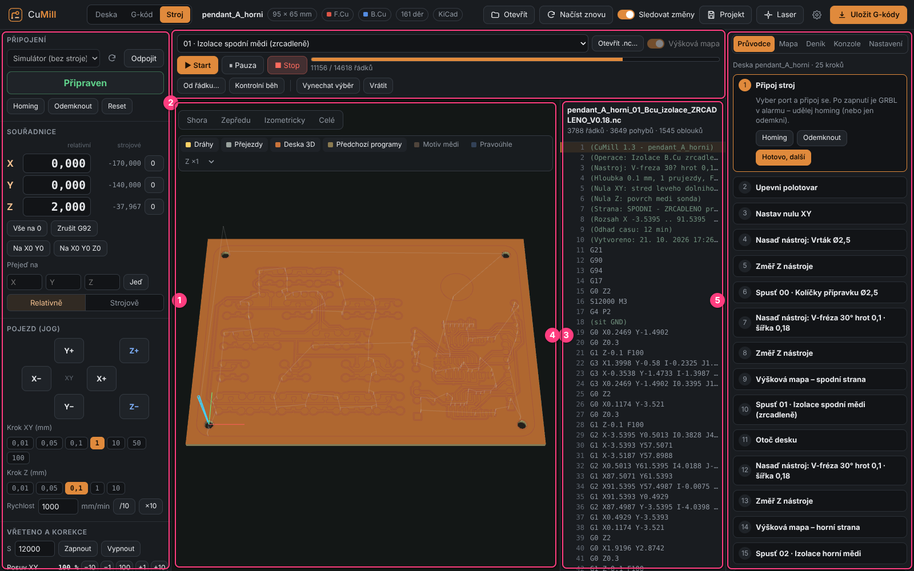

| # | Part | Contents |
|---|------|----------|
| 1 | **Left column** | Připojení (Connection), Souřadnice (Coordinates), Pojezd (Jog), Vřeteno a korekce (Spindle and overrides), Z sonda a nula XY (Z probe and XY zero) |
| 2 | **Program bar** | program selection, Start / Pause / Stop, progress, From line, Check run, Skip |
| 3 | **3D view** | program, live tool position, removal simulation, height map |
| 4 | **G-code listing** | sent lines, line selection |
| 5 | **Right cards** | Průvodce (Wizard), Mapa (Map), Test, Deník (Journal), Konzole (Console), Nastavení (Settings) |

---

## Connection

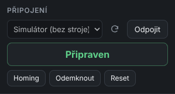

1. Choose the machine's **COM port** (refresh the list with ⟳).
   **Simulátor (bez stroje)** (Simulator, no machine) is a virtual GRBL – try everything without a CNC.
2. Click **Připojit** (Connect). The baud rate is 115200 (GRBL 1.1 standard).
3. The big colored label shows the **machine state**:

| State | Meaning |
|-------|---------|
| **Odpojeno** (Disconnected) | KiMill is not connected |
| **Alarm** | GRBL is locked – after power-on, an emergency stop, hitting a limit switch |
| **Připraven** (Idle) | waiting for commands |
| **Běží** (Run) | running a program |
| **Pojíždí** (Jog) | manual jogging |
| **Pozastaveno** (Hold) | program paused, waiting to resume |
| **Kontrola** (Check) | check run without motion |
| **Homing** | the machine is searching the limit switches |

When the probe input is active (the clip is attached and the tool touches copper),
**"sonda sepnutá"** (probe triggered) is added – a reminder to remove the clip before running a program.

Buttons:

- **Homing** – the machine finds its limit switches and learns where it is (`$H`). Recommended after every power-on.
- **Odemknout** (Unlock) – clears the alarm without homing (`$X`). Only when you know the machine is fine.
- **Reset** – immediate stop and GRBL restart (`Ctrl+X`). The position may be lost.

---

## Coordinates

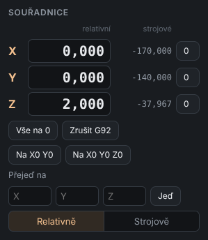

- **relativní** (work – large digits) – workpiece coordinates relative to the **zero** you set.
  G-code uses these.
- **strojové** (machine – small digits) – absolute position from homing.

| Element | What it does |
|---------|--------------|
| **click on a work value** | type what the coordinate should be **here** (the machine doesn't move, `G10 L20`). E.g. type `0` for Z = Z zero here. |
| **0** next to an axis | zero that axis here |
| **Vše na 0** (All to 0) | zero X, Y and Z here |
| **Zrušit G92** (Cancel G92) | cancels a temporary `G92` offset (if another program left one) |
| **Na X0 Y0** (To X0 Y0) | goes up to safe height and moves above the XY zero |
| **Na X0 Y0 Z0** | the same and goes down to Z0 |
| **Přejeď na** (Go to) | enter X / Y / Z (any of them), pick a mode and **Jeď** (Go): *Pracovně* (work) = position from the board zero, *O kolik* (by) = offset from the current position, *Strojově* (machine) = machine coordinates (G53). The tool lifts to a safe height before an XY move. |

> The zero is stored in GRBL (`G54`) and survives a power-off. After power-on just home the machine.

---

## Jog

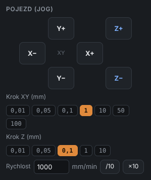

- Arrows **X− X+ Y− Y+** and **Z+ Z−**: **click = one step**, **hold = continuous jog**
  (the machine stops right after release).
- **Krok XY** and **Krok Z** (XY / Z step) are chosen separately (0.01–100 mm and 0.01–10 mm).
- **Rychlost** (Speed) in mm/min, buttons **/10** and **×10**.

---

## Spindle and overrides

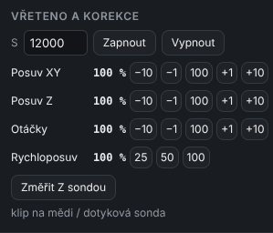

- **S** + **Zapnout / Vypnout** (On / Off) – start the spindle manually at the given speed.
- **Real-time overrides** (immediately, also while running):

| Row | Changes | Note |
|-----|---------|------|
| **Posuv XY** (Feed XY) | sideways feed | −10 / −1 / 100 % / +1 / +10 |
| **Posuv Z** (Feed Z) | plunge feed | rewritten in lines not yet in the machine → takes effect with a small delay |
| **Otáčky** (Spindle) | spindle speed | |
| **Rychloposuv** (Rapid) | rapid speed | 25 / 50 / 100 % |

- **Změřit Z sondou** (Probe Z) – probes the board surface and sets Z0 (copper clip or touch probe,
  per *Settings → Probe*).
  The tool first **moves over copper that is left** – at the zero the copper is often already milled
  away and the tool would have nothing to touch. Automatically it is the blank frame outside the board
  (beyond the cut-out) nearest to the zero; without a frame, a large copper area on the board. Change it in
  *Nastavení → Sonda → Kde měřit Z nástroje* (where to probe Z: automatic / manual X Y / where the tool is).

---

## Machine mode (CNC / laser)

The **CNC (vřeteno) / Laser** switch writes to GRBL:

| | `$32` (laser mode) | `$30` (max. S) |
|---|---|---|
| **CNC (spindle)** | 0 | *Max S pro CNC* (max S for CNC) |
| **Laser** | 1 | *Max S pro laser* (max S for laser) |

Set the max. S values below the switch. The first time they are taken from what the machine currently has
(default 12000 for CNC and 1000 for laser). The current mode is shown above the switch.
Switching works only when idle (also in alarm), not while a program runs.

Before starting a milling program KiMill warns when the machine is in **laser mode** (with `$32=1` the spindle
would switch off on G0 moves), and in laser mode also about `S` higher than `$30`.

## Z probe and XY zero

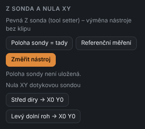

### Fixed Z probe (tool setter) – tool change without the clip

A tool setter is a fixed switch on the machine table. After a tool change KiMill measures the new tool
on it and **recomputes the Z zero by itself** – no need to find the board surface again,
and the height map stays valid.

1. Jog the tool above the center of the setter → **Poloha sondy = tady** (Setter position = here) – the machine position is stored.
2. Set the Z zero of the first tool the usual way (clip / plate / map).
3. **Referenční měření** (Reference measurement) – measures the same tool on the setter and remembers the difference.
4. After every tool change: **Změřit nástroj** (Measure tool). KiMill goes up, moves above the setter,
   measures the new tool and shifts the Z zero by the length difference.

The production wizard offers these steps automatically when the setter is configured.

### XY zero with a touch probe

- **Střed díry → X0 Y0** (Hole center → X0 Y0) – put the probe tip into a hole (e.g. a pin hole) below the top edge.
  KiMill touches the walls in 4 directions, computes the center and sets X0 Y0.
- **Levý dolní roh → X0 Y0** (Lower-left corner → X0 Y0) – put the tip diagonally in front of the lower-left
  board corner, below the top edge. KiMill finds the left and bottom edges and sets X0 Y0 at the corner.

Tip diameter and search distances are in **Settings → Probe and height map**.
Before probing a dialog reminds you where the tip must be.

---

## Running a program

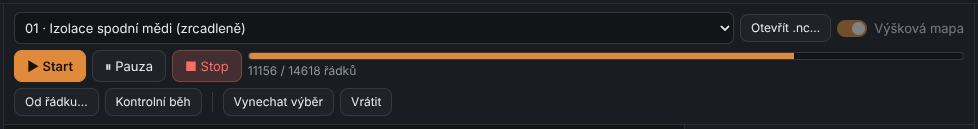

1. Choose the program at the top. KiMill programs of the current board are offered
   (in the right order), or **Otevřít .nc…** opens any file (also from FlatCAM).
2. The **Výšková mapa** (Height map) switch – isolation programs are adjusted by the map
   (see [chapter 8](08-height-map.md)).
3. **▶ Start** opens a summary and check dialog:

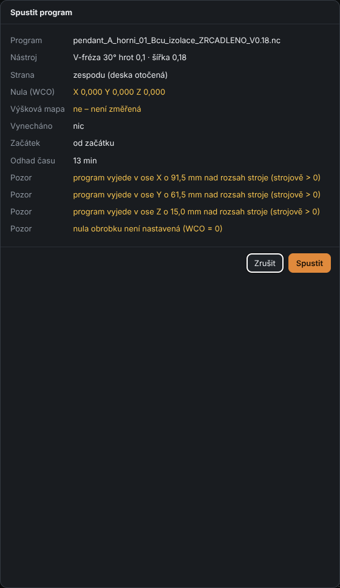

The dialog shows the tool, zero, map, skipped parts and time estimate. **Yellow** lines are warnings, e.g.:

- the program goes **outside the machine travel**,
- **the zero is not set**,
- the height map is **old** (the board may have moved),
- the mounted tool is **different from last time** and Z was not measured.

After **Spustit** (Run) the program runs. The view shows the live tool position and material removal,
with progress and time at the top:

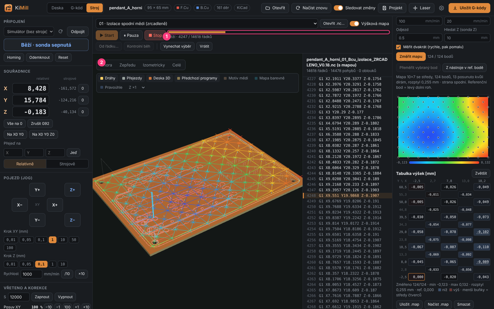

| Button | What it does |
|--------|--------------|
| **⏸ Pauza** (Pause) | smooth stop (feed hold); click again to resume |
| **■ Stop** | smooth stop and end **without losing position** (hold first, then reset) |
| **Od řádku…** (From line…) | runs from the selected line (click a line in the listing). The cutter goes up, moves above the spot and plunges. |
| **Kontrolní běh** (Check run) | GRBL runs the program **without motion** (`$C`) and reports errors |

A GRBL `error:` **pauses** the program and waits for you.

### Skipping part of a program

Click a path in the view (or lines in the listing, `Shift` = range) and press
**Vynechat výběr** (Skip selection). Instead of the skipped path the cutter lifts above the material
and moves to its end. **Vrátit** (Restore) cancels the skip.

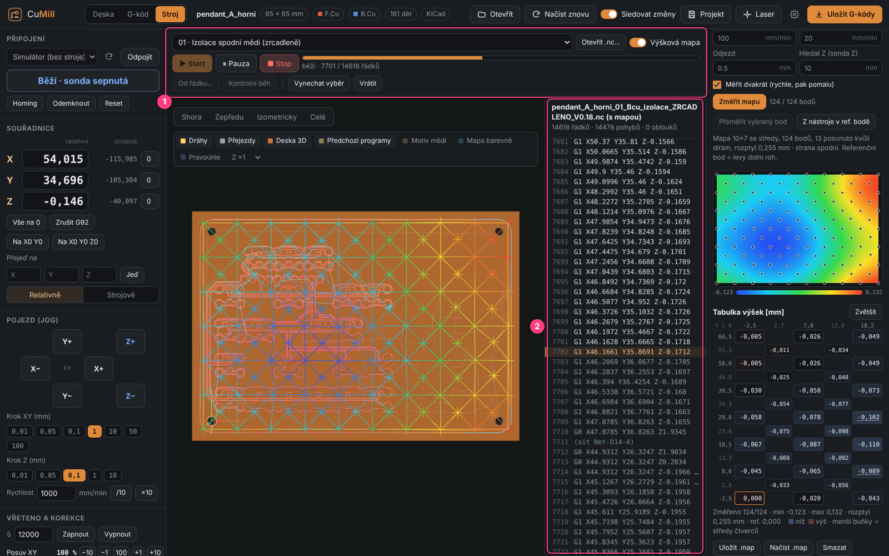

This works **while running**, too – but only for the part not yet in the machine
(GRBL buffers about 15 moves ahead).

### Resume after interruption

When a program is interrupted (alarm, reset, USB disconnect, power failure), an offer
**Pokračovat od řádku …** (Continue from line …) appears below the bar. It starts a little
before the interruption point so nothing is skipped.

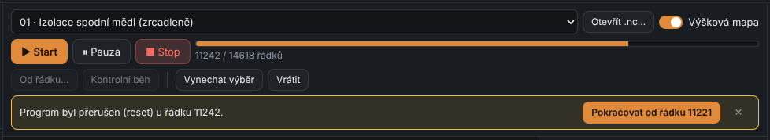

After a power failure **home** first – the XY and Z zero remain stored in GRBL.

---

## Right cards

### Průvodce (Wizard)

Step by step through the whole board – see [chapter 9](09-step-by-step.md).

### Mapa (Map)

Height map – see [chapter 8](08-height-map.md).

### Test

Test cuts on a new material – see [chapter 14](14-material-test.md).

### Deník (Journal)

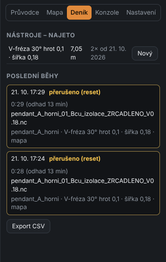

- **Nástroje – najeto** (Tools – distance): how many meters each tool has cut. After replacing it with a new one
  click **Nový** (New) to reset the counter. Handy for tracking V-bit wear.
- **Poslední běhy** (Recent runs): date and time, result (*hotovo* = done, *přerušeno* = interrupted…), real duration and estimate,
  program, board, tool, whether the map was used and from which line.
- **Export CSV** – a table for Excel.

Real run times are used to **refine the time estimate** (see *Settings → Machine and G-code*).

### Konzole (Console)

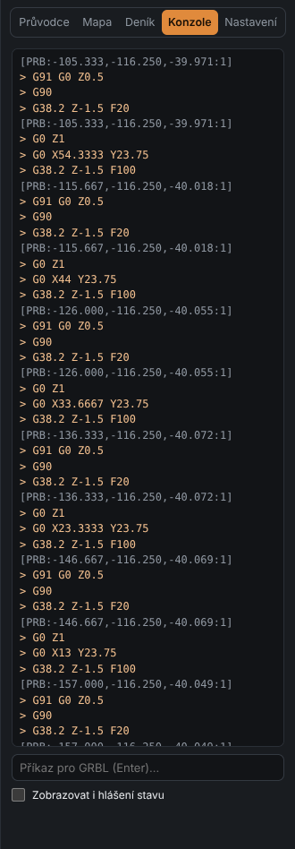

Communication with GRBL. Type any command at the bottom (e.g. `$$`, `G0 X10`, `$I`) and press `Enter`.
**Zobrazovat i hlášení stavu** (Show status reports) also shows the periodic `?` reports.

At the top there are **quick buttons**: `$$` (settings), `$#` (offsets), `$G` (modal state), `$I` (version),
`$X` (unlock), `$H` (homing), `$32=0` / `$32=1` (laser mode off / on).

### Nastavení (Settings)

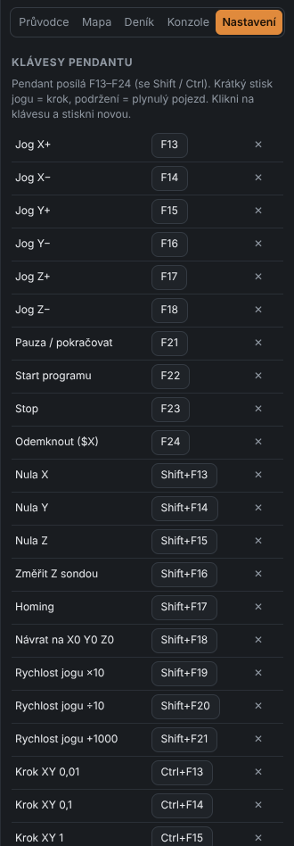

- **Klávesy pendantu** (Pendant keys) – see [chapter 11](11-shortcuts.md).
- **Nastavení GRBL ($$)** – a table of all `$` parameters with (Czech) descriptions.
  Edit a value right in the field – it is written to GRBL on confirmation.

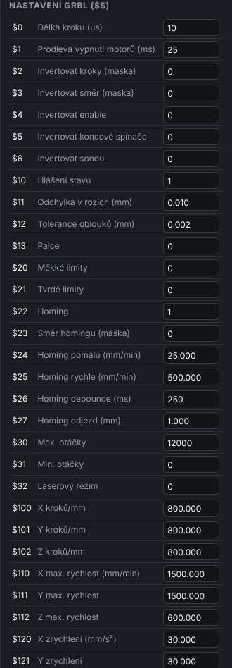

---

## Pendant

KiMill responds to the keys **F13–F24** (also with `Shift` / `Ctrl`) the same way UGS does –
so a pendant that presents itself as a keyboard works out of the box: jogging, steps,
zeroing, Z probing, homing, start / pause / stop.

- Short jog press = **step**, hold = **continuous jog**.
- The KiMill window must be **active** (in front).
- Change key assignments in **Settings → Pendant keys** (click a key and press a new one).

Default assignments are in [chapter 11](11-shortcuts.md#pendant).

[← G-code viewer](06-gcode-viewer.md) · [Contents](README.md) · [Next: Height map →](08-height-map.md)
