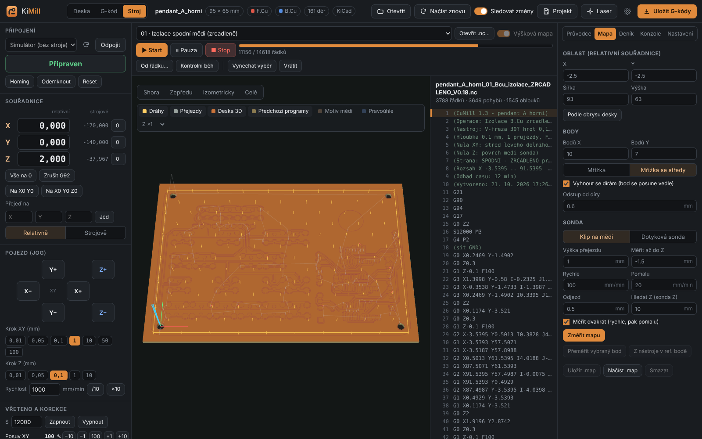
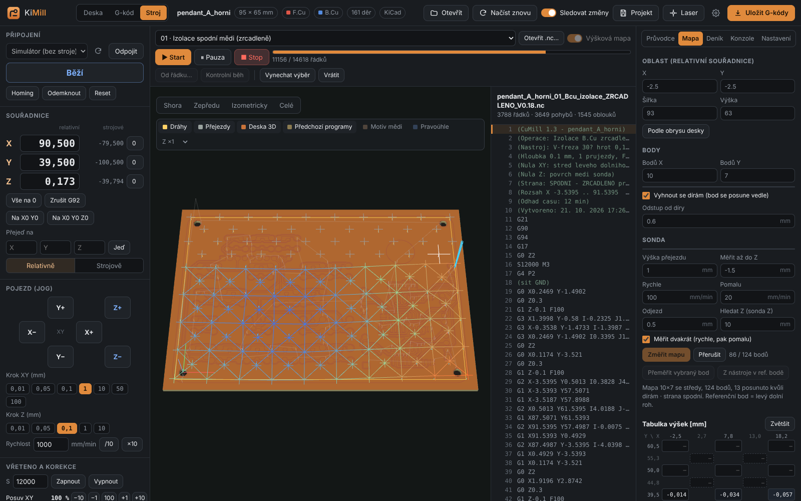
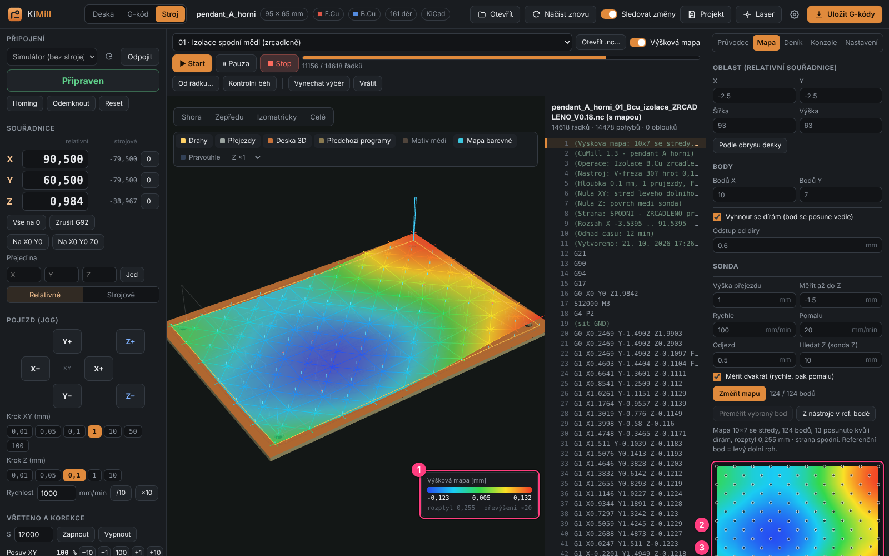
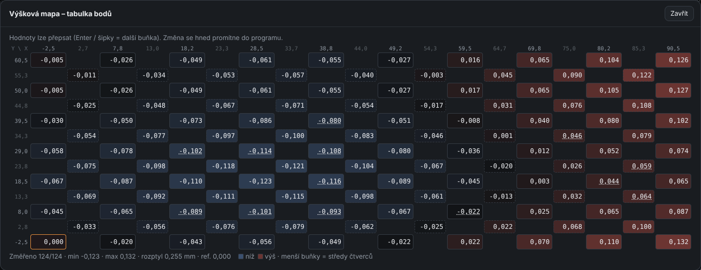

# 8. Height map

[← Machine tab](07-machine-tab.md) · [Contents](README.md) · [Next: Step by step →](09-step-by-step.md)

## Why a map

Isolation is milled only **0.1 mm** deep. But copper-clad board never lies perfectly flat –
the board is bent, the spoilboard uneven, double-sided tape not equally thick.
A 0.1–0.2 mm difference across the board is common. Without a map the cutter just scratches
on one end of the board and goes needlessly deep (making wide grooves) on the other.

A **height map** measures the surface height in a grid of points and KiMill then **raises and
lowers the cutter** while milling, keeping the same depth across the whole board.
Like in Candle, just more convenient.

## What you need

- A **copper clip** (most common): an alligator clip on the tool, the other wire on the board copper,
  connected to the probe input of the GRBL board. The cutter itself is the probe.
- or a **touch probe** – then after probing the map you mount the tool and measure its Z
  at the reference point.

The probe type is set in **Mapa → Sonda** (Map → Probe), or in **Settings → Probe and height map**.

## Procedure

### 1. Prepare the machine

- Connect, home, set the **XY zero**.
- Set an **approximate Z zero** on the board surface (e.g. **Změřit Z sondou** – Probe Z).
  The map is measured relative to it.
- At the top select the **copper isolation** program of the side you will mill.

### 2. Set up the map

Open the **Mapa** (Map) card on the right:

| Field | Meaning |
|-------|---------|
| **Oblast X, Y, Šířka, Výška** (Area X, Y, Width, Height) | where to probe (work coordinates). **Podle obrysu desky** (From board outline) or *Podle programu* (From program) fills it in. |
| **Bodů X / Bodů Y** (Points X / Y) | grid size (e.g. 10 × 7) |
| **Mřížka / Mřížka se středy** (Grid / Grid with centers) | *with centers* adds a point in the middle of each square – more accurate on a wavy board |
| **Vyhnout se dírám** (Avoid holes) | a point that would fall into a hole is moved aside (by *Odstup od díry* – hole clearance) |
| **Klip na mědi / Dotyková sonda** (Copper clip / Touch probe) | probe type |
| **Výška přejezdu** (Travel height) | how high to move between points |
| **Měřit až do Z** (Probe down to Z) | the lowest Z where the probe looks for the surface (e.g. −1.5) |
| **Rychle / Pomalu** (Fast / Slow) | probing speed (with *Měřit dvakrát* – probe twice – first fast, then precisely slow) |
| **Odjezd** (Retract) | how far the probe lifts after the first touch before the slow probe |

While you set it up, the 3D view shows the **planned points as vertical lines** (like Candle) –
you immediately see whether the area fits the board and the points avoid holes.

### 3. Probe

Click **Změřit mapu** (Probe map). The machine visits all points, goes down in each, touches the copper
and records the height. Points get colored in the view and the table fills up:

When done:

- with the **clip** the **Z zero is set to the surface at the reference point** (lower-left corner of the map),
- with a **touch probe** mount the tool and press **Z nástroje v ref. bodě** (Tool Z at ref. point).

### 4. Check the result

1. **3D colored surface** with a legend – blue = low, green, yellow, red = high.
   Exaggerated ×20 so the difference is visible. Toggle with the **Mapa barevně** (Map in color) chip.
2. **2D color map** from the top with the probe points. **Click** to select the nearest point.
3. **Height table** – like in Candle.

### Height table

- **columns = X**, **rows = Y** (in mm, highest Y at the top), cells = **measured Z** in mm,
  relative to the reference point (it shows 0.000 and is framed),
- with *Grid with centers* the **square centers** are smaller dashed cells between the rows,
- **cell color**: blue = lower than average, red = higher,
- you can **overwrite** a value (e.g. an obviously wrong point) – `Enter` or arrows
  jump to the next cell, the change is applied to the program immediately,
- **Zvětšit** (Enlarge) opens the table in a large window,
- below the table: how many points are measured, min, max, spread.

A single point can be **re-probed**: select it (in the table or the 2D map) and press
**Přeměřit vybraný bod** (Re-probe selected point).

### 5. Run the program

The **Výšková mapa** (Height map) switch above the program must be on. KiMill adjusts the isolation
(and silkscreen engraving) program: splits straight moves into pieces of max. 1 mm, replaces arcs
with lines and adds the map height to every point (bicubic interpolation like Candle; triangles
for a grid with centers).

> The map is used **only for copper isolation and silkscreen engraving**, not for drilling and cut-out –
> 0.1 mm doesn't matter there.

## Tool change and the map

When you change the tool after probing the map, measure its Z **at the map reference point**
(the Wizard offers *Změřit Z v ref. bodě mapy*), or on the **fixed Z probe (tool setter)**
([chapter 7](07-machine-tab.md#fixed-z-probe-tool-setter--tool-change-without-the-clip)).
The map then stays valid.

## The other side of the board

After flipping the board, probe a **new map for the other side** – the board now lies differently.
KiMill remembers for which side the map was probed (shown below the map settings), and the Wizard
adds probing a new map after the flip. Before starting KiMill warns when the map is older than 3 hours.

## Saving and loading

- **Uložit .map / Načíst .map** (Save / Load .map) – a file in Candle's format.
- The map is also saved in the **`.kimill` project**.
- **Smazat** (Delete) – discards the map.

[← Machine tab](07-machine-tab.md) · [Contents](README.md) · [Next: Step by step →](09-step-by-step.md)
