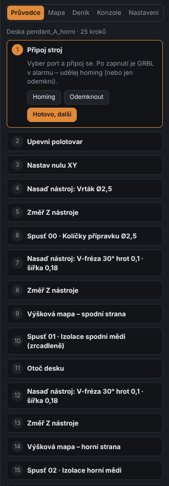

# 9. Two-sided board step by step

[← Height map](08-height-map.md) · [Contents](README.md) · [Next: Application settings →](10-app-settings.md)

This chapter walks through making a two-sided board on a CNC 3018 – from clamping to cut-out.
These are exactly the steps the **Průvodce** (Wizard) in the **Stroj** (Machine) tab offers
(the card on the right), only there each step has its buttons.

The current step is expanded and framed. The step's buttons do what is needed
(homing, Z probing, map, starting a program), **Hotovo, další** (Done, next) moves on.
Click any step to go back to it. **Začít znovu** (Start over) resets the wizard.
Finished steps show ✓.

## What you need

- double-sided copper-clad board, e.g. 100 × 70 × 1.5 mm,
- **jig**: an MDF spoilboard screwed to the machine table (best surfaced once with the mill),
- **pins** Ø2.5 mm (pieces of steel wire or a nail without the head),
- double-sided tape or clamps,
- tools: 2.5 drill (pins), **30° V-bit** (isolation), 0.4–1.0 drills, 1.8 end mill (cut-out),
- a **clip** (alligator clip) for Z probing.

## Procedure

### 1. Connect the machine

**Stroj** tab → choose the port → **Připojit** (Connect) → **Homing**.

### 2. Fix the blank

Tape the board to the jig with double-sided tape (whole area, so it doesn't spring).
The pin holes are drilled by the first program through the board into the MDF.

### 3. Set the XY zero

Jog the tool (or use the pendant) to where the zero should be – per the **Nula XY** (XY origin) setting
(default: *center of the lower-left pin*; its position is shown in the board preview).
In the Wizard click **Nulovat X Y tady** (Zero X Y here).

> Tip: put the zero a bit away from the blank's edge so the whole board is on copper.
> The pin positions relative to the board are visible in the Board tab preview.

### 4. Mount the tool and measure Z

Ø2.5 drill. Attach the clip to the tool, the other wire to the copper → **Změřit Z tady** (Probe Z here).
Then **remove the clip**!

### 5. Drill the pin holes

**Spusť 00 · Kolíčky přípravku** (Run 00 · Jig pins) → check the summary → **Spustit** (Run).
Then push the pins into the holes (tight fit).

### 6. Tool change: V-bit

Change to the V-bit, measure Z (clip, or **Změřit na Z sondě** – Measure on tool setter – if you have one).

### 7. Height map – bottom side

Keep the clip attached. **Změřit mapu** (Probe map) – the area is taken from the board outline,
points avoid holes. After probing Z zero = surface at the reference point.
Details in [chapter 8](08-height-map.md).

### 8. Bottom copper isolation

**Remove the clip!** **Spusť 01 · Izolace spodní mědi (zrcadleně)** (Run 01 · Bottom copper isolation, mirrored).
The bottom side is milled first – the board is still taped down over its whole area.

### 9. Flip the board

Untape the board, **flip it with the top edge toward you** (over the horizontal axis – per the
*Flipping to the bottom side* setting) and put it on the pins. **The XY zero stays** – it is on the pin.
Tape the board down again.

### 10. Tool, Z and map – top side

Measure Z (the board surface is elsewhere now) and probe a **new height map** for the top side.

### 11. Top copper isolation (and silkscreen engraving)

**Spusť 02 · Izolace horní mědi** (Run 02 · Top copper isolation). Silkscreen engraving runs right after,
with the same tool.

### 12. Drilling

For each drill: tool change → measure Z → run the drilling program. From smaller to larger diameters.

The wizard button **Najet na měď a změřit Z** (move over copper and probe Z) first loads the program of that
drill and moves over copper that is left after isolation (the frame outside the board) – at the zero the
copper is usually milled away already. The step is ticked once Z is measured for this program.

With **remaining copper with a second tool** enabled, it runs right after the isolation of the same side:
change to the end mill → measure Z → run *Zbylá měď* (remaining copper).

### 13. Cut-out

1.8 mm end mill → measure Z → **Run board cut-out**. With tabs the board stays in the blank –
cut the tabs with a knife and sand the edges.

### 14. Done

Remove the board, deburr the edges and **check the isolation** – with a multimeter make sure that
neighbouring nets are not connected (especially GND and power).

## After-production check

- Gaps between tracks clean? If not, increase the depth by 0.02 mm or add a pass.
- Tracks too narrow? Measure the groove width and enter it into **Šířka řezu** (Cut width).
- Top and bottom don't match? Check that the pins fit the holes tightly and that the right
  **flip** (horizontal / vertical axis) is set.
- Wire the vias and solder them on both sides (the board has no plating).

[← Height map](08-height-map.md) · [Contents](README.md) · [Next: Application settings →](10-app-settings.md)
