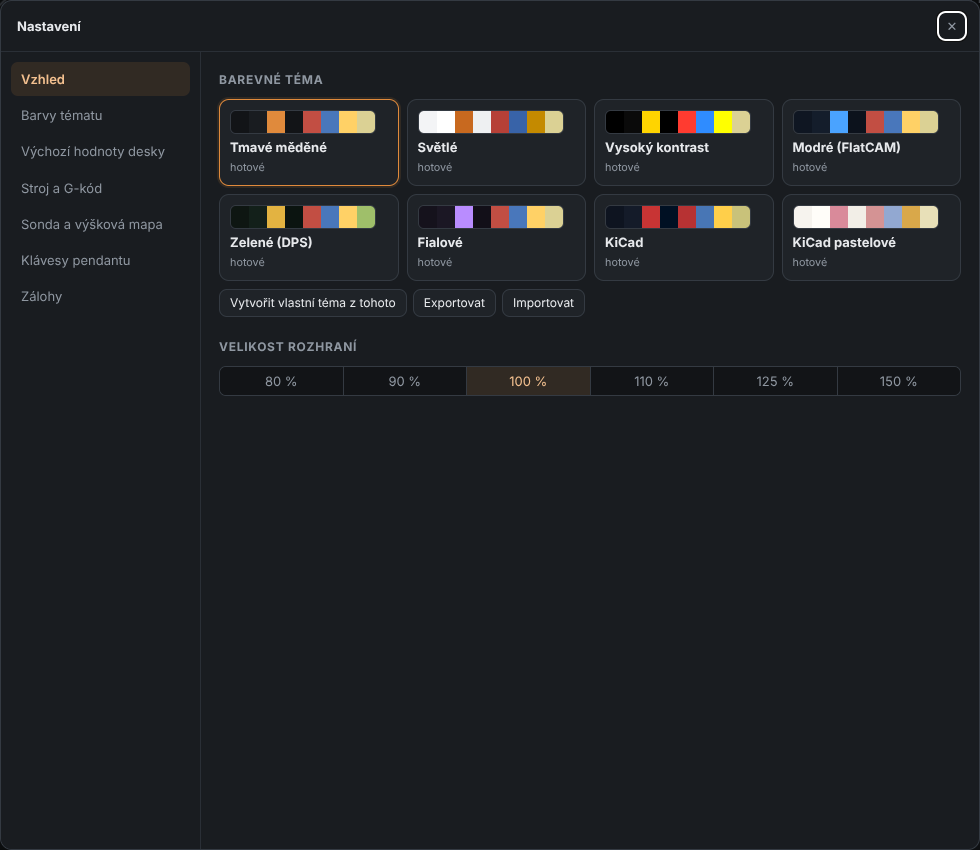
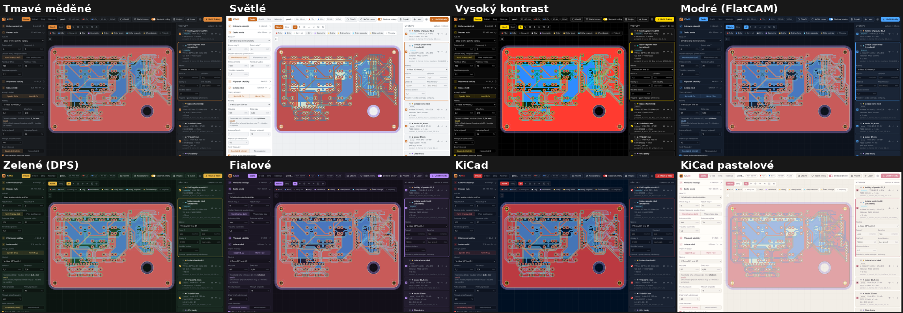
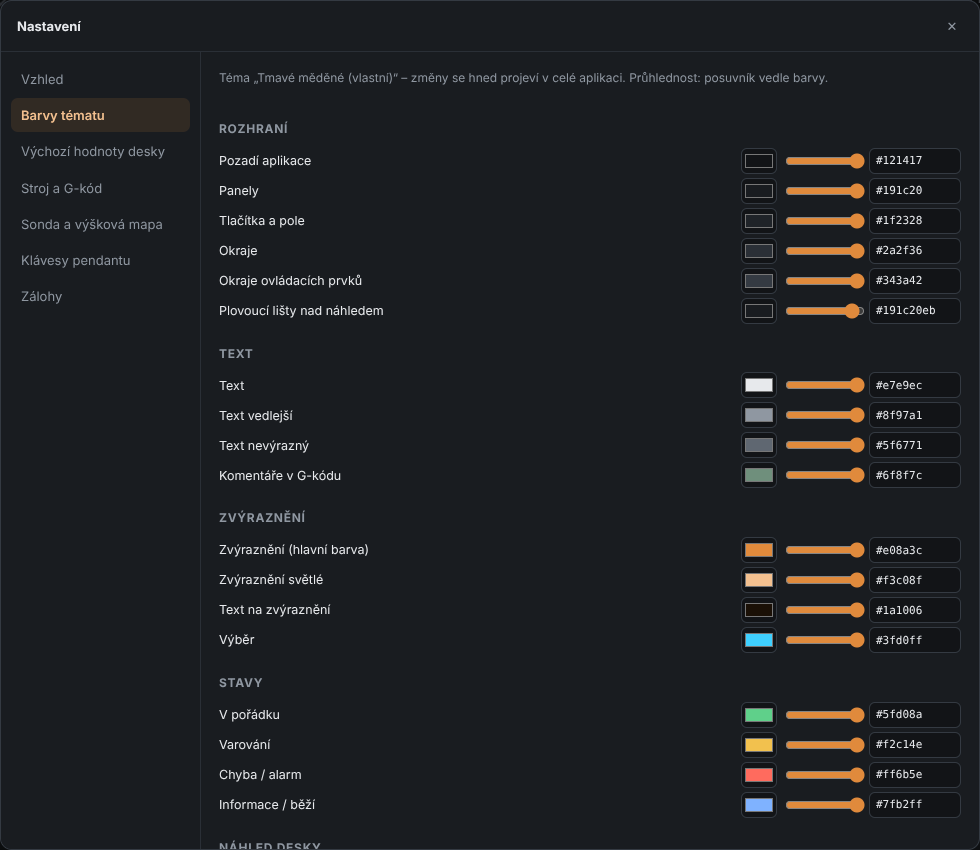
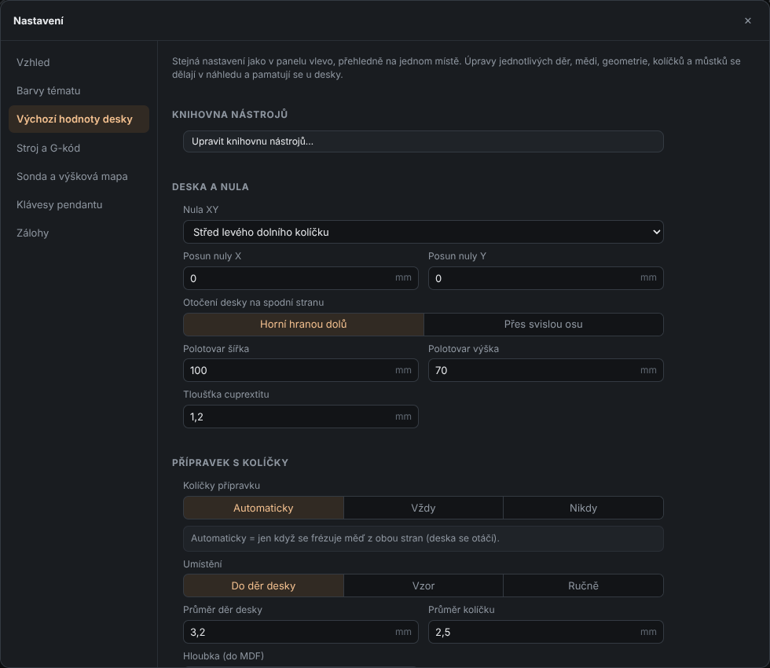
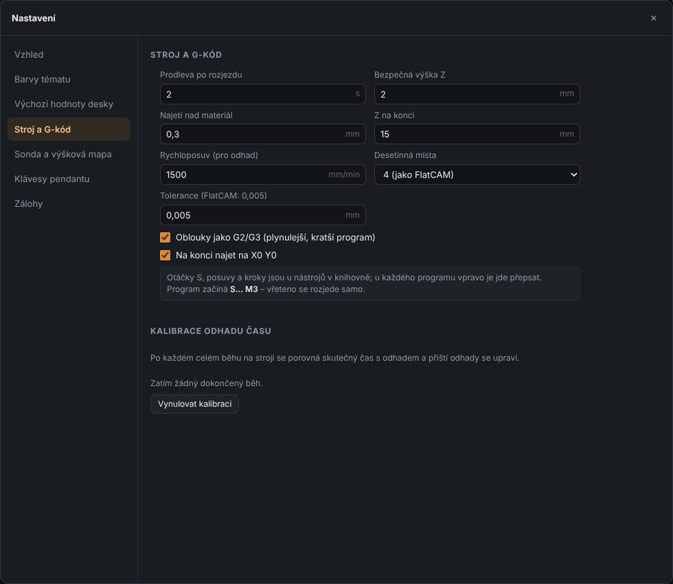
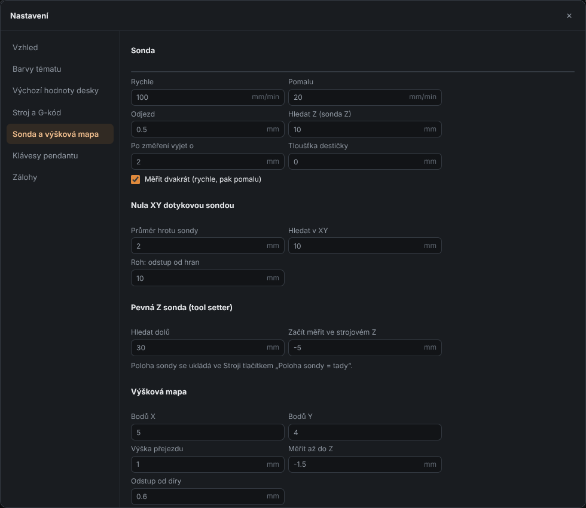
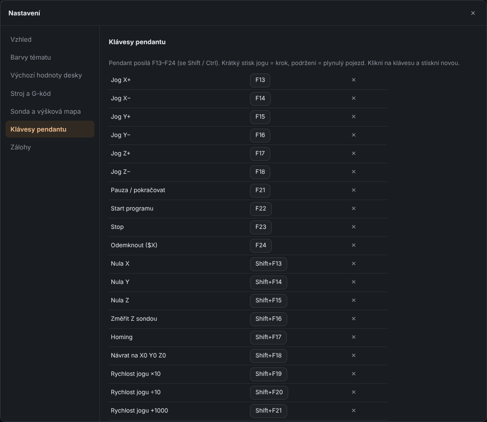
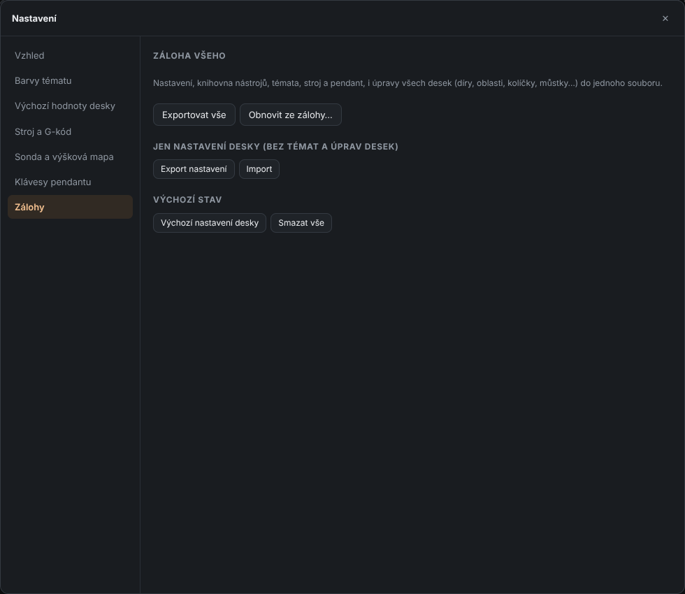

# 10. Application settings and themes

[← Step by step](09-step-by-step.md) · [Contents](README.md) · [Next: Shortcuts →](11-shortcuts.md)

Open the **Nastavení** (Settings) window with the gear ⚙ at the top right or `Ctrl+,`.
Pages are on the left, their content on the right. Close with `Esc` or ✕ – changes are saved immediately.

## Vzhled (Appearance)

- **Barevné téma** (Color theme) – click a theme card. Built-in themes:
  *Tmavé měděné* (Dark copper, default), *Světlé* (Light), *Vysoký kontrast* (High contrast),
  *Modré (FlatCAM)* (Blue), *Zelené (DPS)* (Green PCB), *Fialové* (Purple), *KiCad*, *KiCad pastelové* (KiCad pastel).
- **Velikost rozhraní** (UI size) – 80–150 % (for a small laptop or a big monitor).
- **Vytvořit vlastní téma z tohoto** (Create custom theme from this) – copies the current theme and opens the color editor.
- For custom themes: rename, duplicate, delete, **export / import** (send a theme file to a friend).

A few of the themes:

## Barvy tématu (Theme colors – custom theme)

Every color of a custom theme can be changed separately – including **transparency** (slider).
Colors are grouped: interface, text, highlights, states (OK / warning / error), board preview
(top and bottom copper, holes, outline…), paths of each operation, 3D viewer and simulation.
Changes apply to the whole application immediately. Built-in themes can't be edited –
create your own copy first.

## Výchozí hodnoty desky (Board defaults)

The same settings as the left panel of the Board tab (tools, origin, pins, isolation, holes,
geometry, silkscreen, cut-out), in one place.

## Stroj a G-kód (Machine and G-code)

G-code parameters (same as the *Machine and G-code* section on the left) and
**Kalibrace odhadu času** (Time estimate calibration): after every completed run on the machine
KiMill compares the real time with the estimate and adjusts future estimates for that type of
operation (e.g. *Isolation × 1.18*). **Vynulovat kalibraci** (Reset calibration) starts over.

## Sonda a výšková mapa (Probe and height map)

| Field | Meaning |
|-------|---------|
| **Klip na mědi / Dotyková sonda** | probe type for Z probing and the map (copper clip / touch probe) |
| **Rychle / Pomalu** (Fast / Slow) | search speed (mm/min) |
| **Odjezd** (Retract) | lift between fast and slow probing |
| **Hledat Z (sonda Z)** (Z search distance) | how far down the surface is searched |
| **Kde měřit Z nástroje** (Where to probe Z) | *Automaticky* – over copper outside the board (blank frame), *Ručně* – given X Y in work coordinates, *Kde stojí nástroj* – no move |
| **Po změření vyjet o** (Lift after probing) | lift when done |
| **Tloušťka destičky** (Plate thickness) | for a touch plate – how much its surface is above the board |
| **Měřit dvakrát** (Probe twice) | first fast, then slow and precise |
| **Průměr hrotu sondy** (Probe tip diameter) | for XY zero with the touch probe |
| **Hledat v XY** (XY search distance) | how far to look for the hole wall / board edge |
| **Roh: odstup od hran** (Corner: edge offset) | where corner probing starts |
| **Pevná Z sonda – Hledat dolů / Začít měřit ve strojovém Z** | tool setter: search distance / start height in machine Z |
| **Výšková mapa** | default point counts, travel height, probe depth, hole clearance, grid / with centers |

## Klávesy pendantu (Pendant keys)

List of actions and their keys. Click a key and press a new one (also with `Shift` / `Ctrl`),
✕ removes the assignment, **Výchozí (jako UGS)** (Default, like UGS) restores the original.
Default keys are listed in [chapter 11](11-shortcuts.md#pendant).

## Zálohy (Backups)

- **Exportovat vše** (Export everything) – settings, tool library, themes, machine, pendant
  and edits of **all** boards into one `.json` file.
- **Obnovit ze zálohy…** (Restore from backup…) – loads a backup (replaces the current state).
- **Export / Import nastavení** – board settings only (without themes and board edits).
- **Výchozí nastavení desky** (Board defaults) – resets settings and tool library to factory state.
- **Smazat vše** (Delete everything) – a completely clean start (make a backup first).

[← Step by step](09-step-by-step.md) · [Contents](README.md) · [Next: Shortcuts →](11-shortcuts.md)
