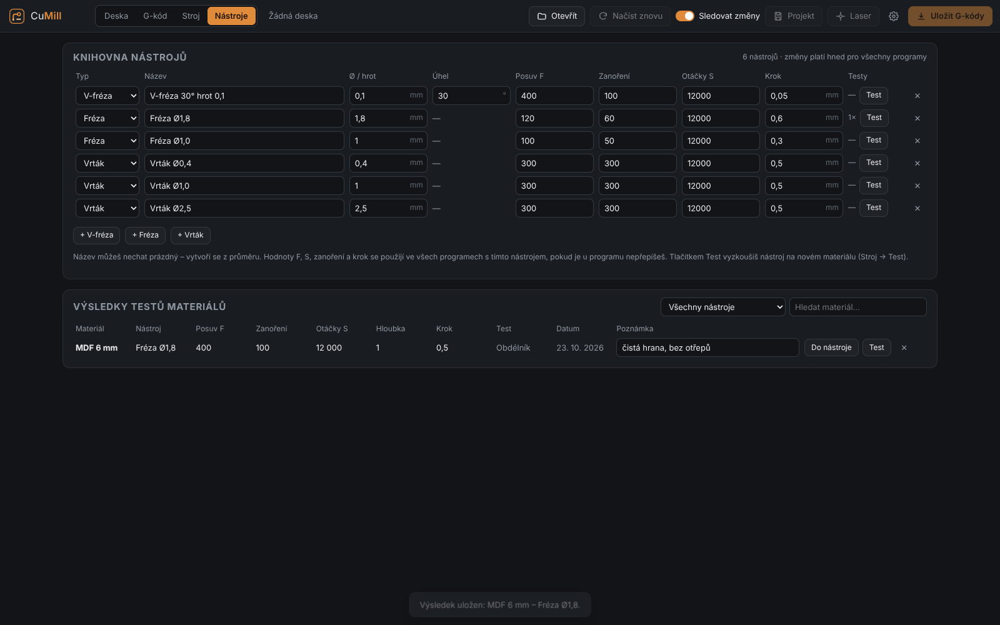
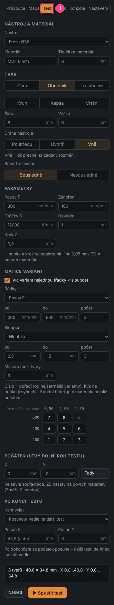
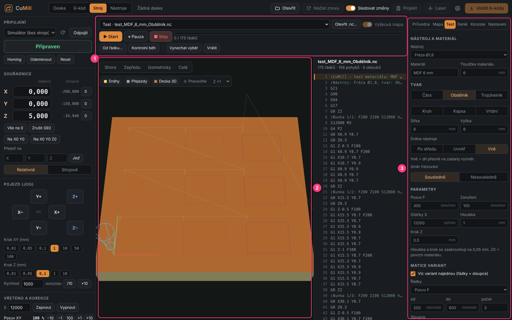
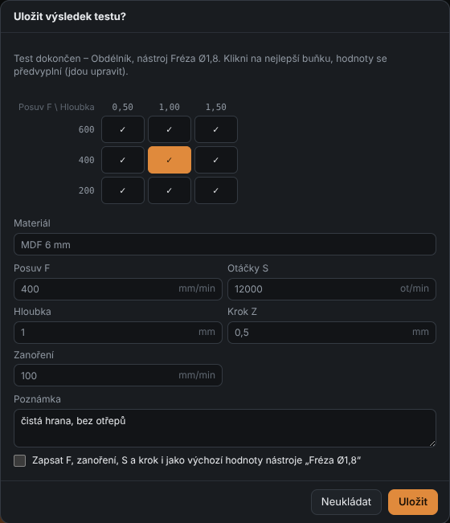

# 14. Material test and the Tools tab

[← Glossary](13-glossary.md) · [Contents](README.md)

With a new material (aluminium, MDF, acrylic, another copper-clad board) or a new tool you don't know
which feed, spindle speed and depth your machine can handle. The **Test** card in the Machine tab
mills a test shape – one, or a whole **matrix of variants** – and you save the best result with the tool.

## Tools tab (`F6`)

The **Nástroje** (Tools) main tab next to Board / G-code / Machine shows the whole tool library
and the saved test results.

**Knihovna nástrojů** (Tool library) – the same table as the former library window (type, name,
diameter / tip, angle, feed F, plunge, spindle S, step-down). Changes apply to all programs immediately.
For each tool:

- **Testy** (Tests) – how many test results are saved for the tool,
- **Test** – opens Machine → Test with this tool,
- **✕** – delete the tool.

**Výsledky testů materiálů** (Material test results) – everything you saved after tests. Filter by tool
and search by material name. For each record:

- **Do nástroje** (To tool) – writes F, plunge, S and step-down as the tool's defaults,
- **Test** – opens a test with these values (e.g. to fine-tune),
- **Poznámka** (Note) – editable right in the table,
- **✕** – delete the record.

The **Upravit knihovnu…** (Edit library…) button in the left panel also opens this tab.

## Test card

**Stroj** (Machine) tab → card **Test (1)** on the right:

### 1. Tool and material

- **Nástroj** (Tool) from the library (its diameter is used for path compensation and pockets).
- **Materiál** – type a name or pick a previously saved one. If a saved result exists for this
  material and tool, the parameters are pre-filled.
- **Tloušťka materiálu** (Material thickness) – for the simulation and a check (warns when the depth is larger).

### 2. Shape

| Shape | Size | Purpose |
|-------|------|---------|
| **Čára** (Line) | length | fastest test of feed and depth |
| **Obdélník** (Rectangle) | width, height | corners, edge quality |
| **Trojúhelník** (Triangle) | side | sharp corners |
| **Kruh** (Circle) | diameter | arcs, hole / pin accuracy |
| **Kapsa** (Pocket) | rectangle (w × h) or circle (diameter), overlap % | area clearing, chip evacuation |
| **Vrtání** (Drilling) | – (diameter = tool) | plunging in place; step-down = depth of one peck |

- **Dráha nástroje** (Tool path; rectangle, triangle, circle): *Po středu* – tool center on the shape;
  *Uvnitř* (Inside) – the hole comes out at the exact size; *Vně* (Outside) – the part comes out at the exact size.
- **Směr frézování** (Direction): *Sousledně* (climb) / *Nesousledně* (conventional).

### 3. Parameters

**Feed F, Plunge, Spindle S, Depth, Step-down.** Depth and step-down are rounded to **0.05 mm**
(the smallest step). Z0 = material surface. Below the parameters are buttons with results saved
earlier for this tool – click to take them over.

### 4. Matrix of variants

Check **Víc variant najednou** (Several variants at once) and choose what changes in the **rows** and in the
**columns** (feed F, spindle S, depth, step-down or plunge) – each with **from**, **to** and **count**
(up to 12). Other values come from Parameters. **Mezera mezi tvary** (Gap) sets the spacing.

The grid below shows the **order** in which cells are milled – from the gentlest variant
(low feed per revolution, small step) to the hardest, so a possible tool break comes at the end.
**Click a cell to skip it** (✕), click again to restore.

### 5. Origin

Lower-left corner of the test in work coordinates. **Tady** (Here) = current tool position.
Before the test set Z0 on the material surface (**Změřit Z sondou** – Probe Z).

### 6. After the test

| Option | What happens |
|--------|--------------|
| **Nahoru (Z na konci)** (Up) | goes up to *Z at end* and stays |
| **Zpět nad počátek** (Back to origin) | goes up and moves above the test origin |
| **Posunout vedle na další test** (Move aside for the next test) | moves by *Offset X / Y* (empty X = test width + gap) and **the origin moves** – the next test can be started right next to it |
| **Na parkovací pozici** (To park position) | moves to the stored machine position (**Parkovací pozice = tady** – Park position = here) |

The spindle is switched off at the end.

### 7. Running

The summary shows the number of shapes, test size and X / Y extent, plus warnings.
**Náhled** (Preview) loads the test as a program (3D view and G-code listing),
**▶ Spustit test** (Run test) starts it right away – through the same confirmation dialog and checks as any program.

1. program bar – the test is listed as *Test · …*,
2. 3D view with removal simulation,
3. Test card.

Pause, Stop and feed / spindle overrides work as with any program.

## Saving the result

After the test finishes (or is stopped) CuMill asks **Uložit výsledek testu?** (Save test result?)

1. For a matrix **click the best cell** – the values are filled in.
2. Adjust the **material** name and the values if needed (step-down and depth at least 0.05 mm).
3. Write a **note** (edge quality, chips, sound…).
4. Optionally **write F, plunge, S and step-down as the tool defaults** too.
5. **Uložit** (Save).

The result appears in the **Tools** tab and as a quick pick in the Test card. The run is also
logged in the **Journal** (with a note for which material it was saved).

## Recommended procedure for a new material

1. Clamp a piece of material, set the XY zero near a corner, probe Z on the surface.
2. First test: **Line**, matrix **Feed F** (rows) × **Depth** (columns), conservative range.
3. When done pick the best cell and save.
4. Second test next to it (*Move aside*): **Rectangle**, matrix **Spindle S** × **Step-down** around
   the feed you found.
5. Finally a **Circle** *Inside* at the hole size you need – measure the real diameter.

[← Glossary](13-glossary.md) · [Contents](README.md) · [Panel →](15-panel.md)
