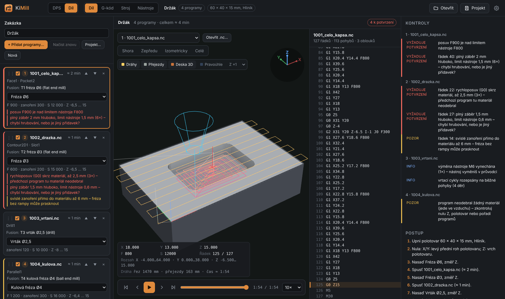
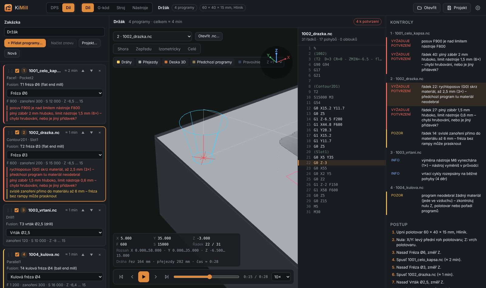
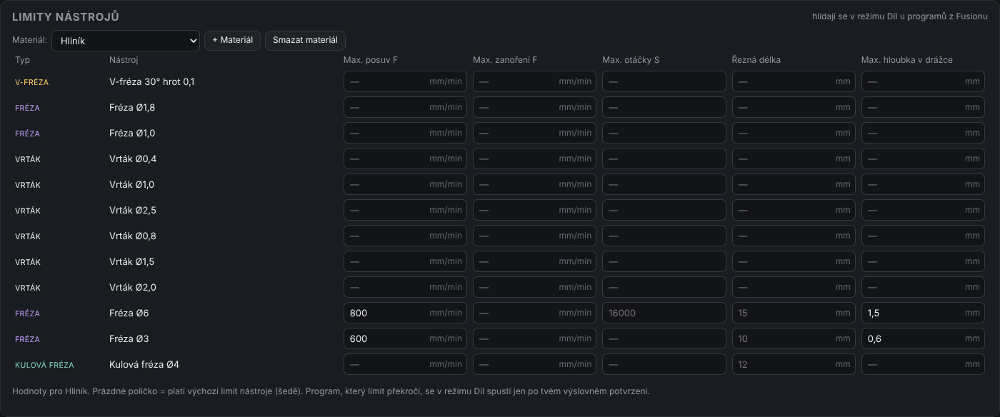
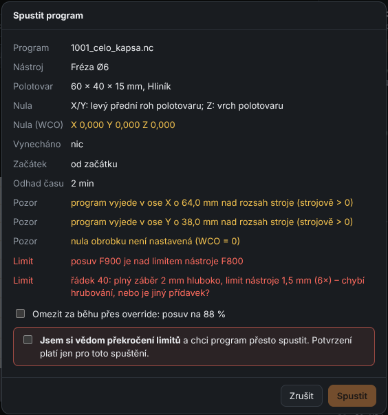

# 16. Part – finished G-code from Fusion 360

[← Panel](15-panel.md) · [Contents](README.md)

**Part** mode is for machining aluminium, brass, wood or plastic parts prepared in
**Fusion 360**. KiMill does not generate G-code here. It takes the finished programs
from Fusion and turns them into one **job**. It checks the tools, limits and material
removal across all programs, and the Machine tab walks you through the job like a board:
tool change, Z probe, start.

This is handy with the Fusion personal licence, which cannot save several tools in one
program. Save each tool separately and KiMill joins them into one sequence.

## Switching the mode

Next to the logo there is a **DPS | Díl** (PCB | Part) switch. In Part mode:

- the **Board** tab is replaced by **Part** (F2),
- **G-code**, **Machine** and **Tools** stay and work with the part programs,
- board-only buttons (Save G-code, Laser, Print 1:1, Watch changes) are hidden.

The mode and the current job are remembered between runs.

## Exporting from Fusion

1. Prepare setups and operations in **Manufacture** as usual.
2. Set the blank in **Setup → Stock** and the zero in **Setup → WCS** (typically the
   front-left corner and the top of the blank).
3. **Post Process** with the **Grbl** post. Save each tool as its own `.nc` file
   (1001, 1002, 1003…). The personal licence requires this anyway.
4. Keep **compensation "In computer"**. GRBL does not support G41/G42.

## The job – left panel

**+ Add programs…** (or dropping files on the tab) loads all `.nc` files at once. New
programs are sorted by name. Reorder them by dragging a card (⋮⋮) or with ▲ ▼.

A program card shows:

- the **checkbox** (include in the job),
- **Fusion operations** (Face1, Adaptive2…) and the **header tool**, e.g.
  `T1 fréza Ø6 (flat end mill)`. It is read from the comment Fusion writes at the top
  of the program,
- the **library tool**. It is assigned automatically by type and diameter. If it is
  missing, pick one, or click **+ Do knihovny** to create it from the header (diameter,
  type, F and S from the program),
- the program's **F, plunge, S and Z range** and time estimate,
- **check findings** (red = needs confirmation, orange = warning).

**Same file name = new version.** After a new export from Fusion, add the files again
or click **Reload**. The order and assigned tools are kept.

What KiMill changes for GRBL (listed in Checks as info):

| In the program | What happens |
|---|---|
| `M6` (tool change) | removed – the wizard handles the tool change |
| drilling cycles `G81`, `G82`, `G83`, `G73` | expanded into plain moves |
| `G98`, `G99`, `G64` | removed |
| `G41`, `G42`, `G43` | **cannot run** (not supported by GRBL) |
| `G28`, `G30` | warning (goes to a position stored in the machine) |
| several tools (T) in one file | needs confirmation (GRBL cannot change them) |

## Blank and zero

Below the programs enter the **blank size** (X × Y × thickness), the **material**, and
where Fusion has the **zero**:

- **X/Y zero**: front-left, front-right, back-left, back-right corner, centre, or custom
  (X, Y of the blank's front-left corner),
- **Z zero**: top of the blank, bottom of the blank (table), or custom.

It must match Fusion. KiMill uses it to simulate the material removal.

**Placing the program in the blank.** If the blank is larger and you do not want the part
in the corner, enter **Program offset X / Y**, or click **Na střed** (machined area to the
centre of the blank) or **K rohu s okrajem…** (to the front-left corner with a margin).
KiMill recalculates X and Y in all programs of the job, including arcs and drilling. The
machine zero stays where Fusion has it (e.g. the blank corner). The offset is shown in the
3D view, in the simulation and in the start dialog. Below the blank it
shows where the programs actually cut and warns if that is far outside the blank.

## Checks and material-removal simulation

After every change KiMill simulates the **whole job in order** in the background. The
blank is a height grid (about 0.05 mm) and each tool has its real shape (flat, ball,
V-bit, drill with point). Each program removes material and the next one sees only what
is left. A bar above the 3D view shows the progress.

| Finding | Level | Meaning |
|---|---|---|
| rapid (G0) through material | **confirmation** | the previous program did not remove the material here (missing, disabled, wrong order) |
| full-width cut deeper than the tool allows | **confirmation** | a finishing tool runs into full material – roughing missing or different stock to leave |
| material above the cutting length | **confirmation** | the shank or holder touches the material |
| first cut deep below the surface | **confirmation** | Z zero or blank thickness does not match Fusion |
| more than 1 mm below the blank bottom | **confirmation** | the tool goes into the spoilboard / table |
| F, plunge or S over the tool limit | **confirmation** | from the tool limits (below); S also over the machine `$30` |
| assigned tool differs from the header | **confirmation** | different diameter or type in the program |
| vertical plunge into material | warning | no ramp or helix (drills are fine) |
| program removed nothing | warning | cutting air – Z zero, blank or order |
| unsupported G41/G42/G43 | **cannot run** | fix the post processor |

Clicking a finding with a line number selects the program, moves the 3D view to that spot
(red cross) and scrubs the simulation to that line. The 3D view always shows the blank
**after all previous programs** plus the selected program's paths. The **G-code** and
**Machine** tabs show the same.

The grid simulation ignores tiny touches at edges (about 0.1 mm tolerance). It catches
gross mistakes; it does not replace the Fusion simulation.

## Tool limits (Tools tab)

The **Tools** tab has a **Tool limits** card below the library:

- **Max. feed F**, **Max. plunge F**, **Max. spindle S**,
- **Cutting length**: how deep the tool may go into material before the shank touches,
- **Max. slot depth**: deepest full-width cut (side cuts with a small stepover, such as
  adaptive roughing, are not limited by it).

Set limits **on the tool (default for all materials)** and per **material** (Aluminium,
Brass, Wood, Plastic, + your own). An empty field for a material means the tool default
applies (shown in grey). An empty default means the limit is not checked. Choose the job
material at the blank.

The library has a new tool type, **ball end mill**.

## Starting over a limit

If a program exceeds something, it **does not start without your explicit confirmation**.
The start dialog (Machine → Start) lists the findings in red and **Start** stays disabled
until you either:

- tick **"I am aware the limits are exceeded and want to run the program anyway"**, or
- choose **"Limit while running via override"**. This works when only F and S are over:
  KiMill sets the feed and spindle override so the program stays within the limit (GRBL
  allows 10–100 %).

The confirmation is valid **only for this one start**. You are asked again next time.
What you confirmed is written to the console. If the previous part program was limited
via override, the next one resets the override to 100 %.

**Cannot run** findings (G41/G42/G43) cannot be confirmed. Fix them in Fusion.

## Machining – wizard in the Machine tab

For a part the wizard has these steps:

1. Connect the machine.
2. Clamp the blank (size and material from the job).
3. Set the X Y zero. The text reminds you where it is in Fusion.
4. For each tool: **Mount the tool** → **Probe Z** (touch plate, clip on conductive
   material, tool setter, or **Z same as previous** for tools of equal length) →
   **Start** the program.

The height map is not used in Part mode. Resume after interruption, check run, skipping
part of a program and the journal work as for boards.

## Part project

**Project…** saves the job to the projects folder as `.kimill`: programs (including
copies), order, assigned tools, blank and material. After that it is saved continuously.
Opening it switches to Part mode and loads the current files from disk. If they are no
longer at the original place, the copies stored in the project are used. A part project
does not change the tool library.
